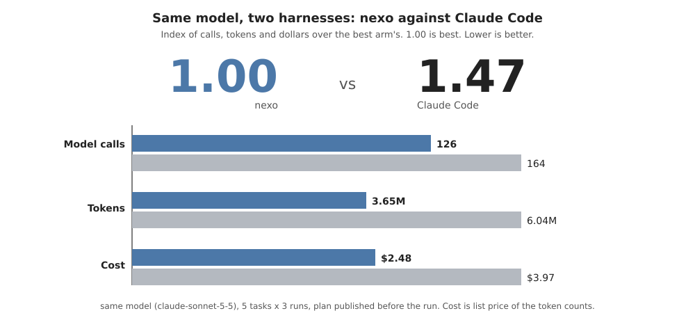
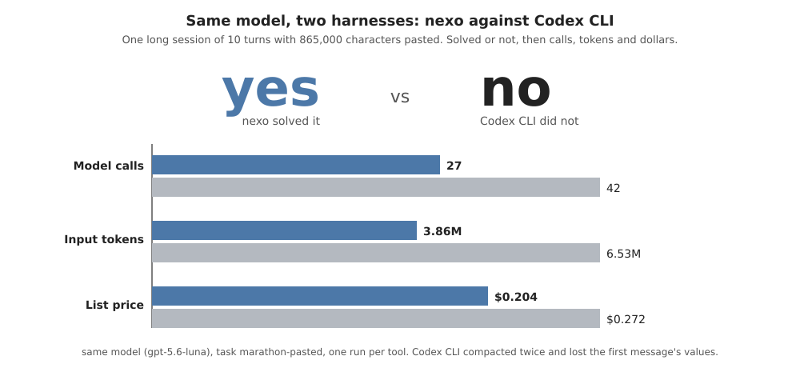
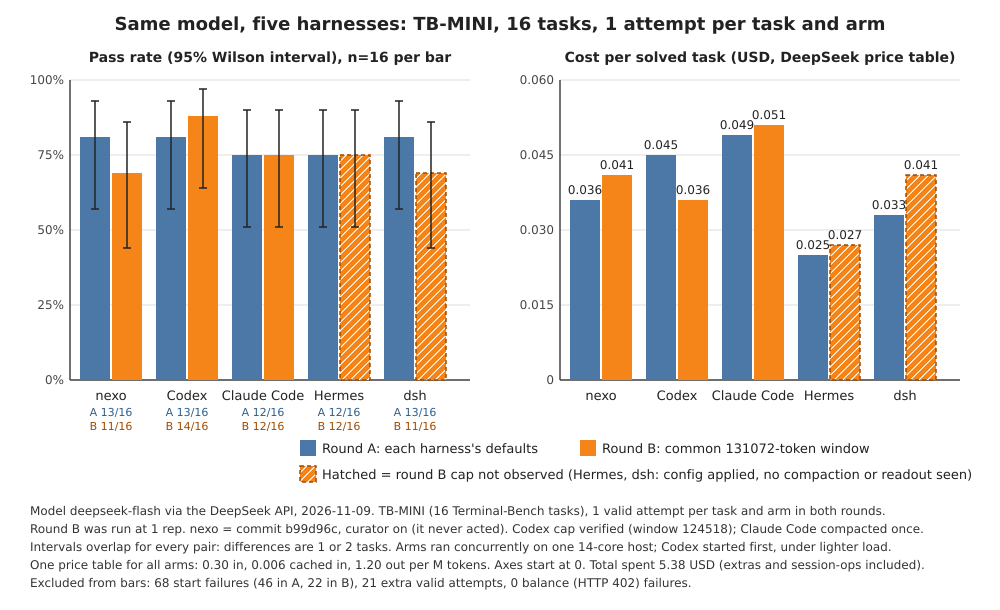
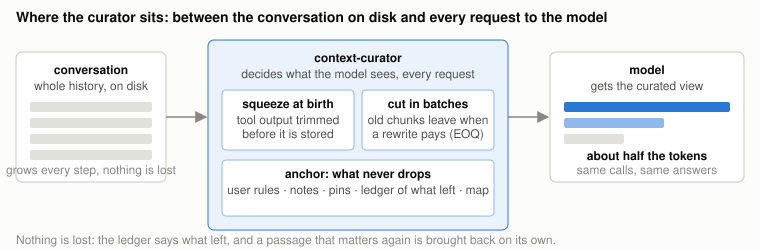
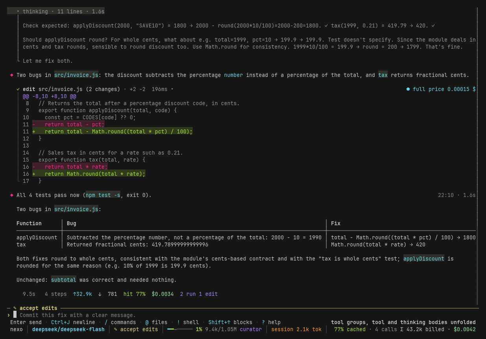

<div align="center">


# nexo

### The coding agent that doesn't run out of context.

**No compaction. No summaries. The whole history stays on disk.**

<a href="#proof"></a>

[**Install**](#install) · [**Proof**](#proof) · [**How it works**](#how-it-works) · [**Providers**](#providers) · [**Full guide**](nexo/README.md)

[](https://github.com/Locotir/nexo/actions/workflows/ci.yml)
[](https://www.rust-lang.org)
[](LICENSE)
[](#install)
[](#providers)
[](https://www.paypal.me/locotir)

</div>

```sh
curl -fsSL https://raw.githubusercontent.com/Locotir/nexo/main/install.sh | sh    # Linux; Windows and source below
```

nexo is a terminal coding agent written in Rust, for any model provider. Its context curator keeps long sessions
small without summaries: the whole history stays on disk, and the model is sent only what the next step needs.
It runs as a full-screen TUI, headless for scripts and CI, or inside editors over the Agent Client Protocol (ACP).

<p align="center"></p>

<sub>Recorded from the real TUI playing a scripted session: the replies, tool results and figures on screen are sample data.</sub>

| | An agent that compacts | nexo |
| --- | --- | --- |
| The window fills up | a summary replaces the work | nothing is summarized, the history stays on disk |
| The exact error line from early in the session | gone with the summary | comes back by itself when a step names it |
| The provider's prompt cache | restarts after each compaction | keeps hitting: the view is rewritten only at an epoch |

## Install

**Linux** (downloads the ready-built file, checked against its SHA-256, to `~/.local/bin`):

```sh
curl -fsSL https://raw.githubusercontent.com/Locotir/nexo/main/install.sh | sh
```

**Windows** (PowerShell, to `%LOCALAPPDATA%\Programs\nexo`):

```powershell
irm https://raw.githubusercontent.com/Locotir/nexo/main/install.ps1 | iex
```

**macOS** has no ready-built file: the script builds from source, untested. From source on any system:
`cargo install --locked --git https://github.com/Locotir/nexo nexo-cli`. CI tests both installers on Linux x64 and ARM and Windows x64 and ARM.

nexo checks for a newer release in the background; `nexo update` installs it. Turn the check off with
`[ui] update_check = false` or `NEXO_NO_UPDATE_CHECK=1`.

## First run

```sh
export DEEPSEEK_API_KEY=...      # or ANTHROPIC_API_KEY, OPENAI_API_KEY, GEMINI_API_KEY, ...
cd your/project
nexo                             # full-screen interface
nexo -p "run the tests and fix what fails"   # headless: prints the reply
nexo --continue                  # resume the latest session here
nexo doctor                      # checks files, provider, model and key with one live call
nexo --provider ollama --model qwen3:8b       # no key: a local model
```

The status bar shows context use and cost, and you can click it. The screen stays quiet by default;
`[ui] detail = "full"` brings back every figure and key hint. Each session reopens on its own provider and model.
Pick a policy in `~/.nexo/config.toml`: `[context] policy = "curator"` (`auto | plain | compact | curator`).

## Proof

Same model, same tasks. Each chart has its date, and what it does not show is one click under it.

### vs Claude Code

**40% fewer tokens. Every task completed. Lower cost in every run.**

<picture>
  <source media="(prefers-color-scheme: dark)" srcset="docs/img/bench-claude-code-dark.svg">
  
</picture>

<details>
<summary>Setup and limits</summary>

2026-11-10, `claude-sonnet-5-5`, nexo `bf57ed4`, 5 tasks, 3 runs each, plan published before the run. nexo completed all of its runs; Claude Code missed one. The sessions were short, so this does not measure eviction against compaction, and the blind vote on page quality was not held. [Plan](docs/bench/PLAN.md), [results](docs/bench/RESULTS.md).

</details>

### vs Codex CLI

**One long session, one run each: nexo solved it with 41% fewer input tokens and no compaction. Codex CLI did not solve it.**

<picture>
  <source media="(prefers-color-scheme: dark)" srcset="docs/img/bench-codex-dark.svg">
  
</picture>

<details>
<summary>Setup and limits</summary>

2026-11-10, `gpt-5.6-luna`, one session of 10 turns. Codex CLI compacted twice and lost five values the user had given early on. nexo took 27 model calls against 42. One run per tool is a demonstration, not a statistic, and on short tasks the two tie. [Results](docs/bench/CODEX.md).

</details>

### vs four other harnesses

**On the tasks all five solved, nexo needed the least steps, tokens and dollars combined.**

<picture>
  <source media="(prefers-color-scheme: dark)" srcset="docs/img/race-dark.svg">
  
</picture>

<details>
<summary>Setup and limits</summary>

2026-11-09, `deepseek-flash`, nexo `b99d96c`, one attempt per task, 16 Terminal-Bench tasks. The combined index is 1.05 and 1.04, where 1.00 would mean best on all three. nexo is not the lowest in every column: in round A dsh costs less in dollars. Every harness solved 11 to 14 of 16 tasks, a tie within noise, and in round B the curator never acted. Tasks where any agent downloaded the benchmark's own solutions are left out for all. Correction 2026-11-10: the Hermes run of circuit-fibsqrt in round A ended with an error and recorded no usage, so it was counted as zero; its usage is now read from the agent's own log. [Details](docs/results.md#harness-race-2026-11-09).

</details>

<sub>Names and logos belong to their owners and are used only to identify the tools. Measure your own tasks with [`nexo bench`](docs/usage.md#the-benchmark-nexo-bench).</sub>

## How it works

Every agent re-sends its whole history on each call, and when the window fills it compacts: a summary replaces the work,
the exact error line is gone, and the prompt cache restarts. nexo keeps the whole history on disk and sends a curated view
built for the next step. The view is rewritten only at an epoch, so the provider's cache keeps hitting; what a request names
comes back by itself; your rules stay pinned; a resumed session gets the same view.

<picture>
  <source media="(prefers-color-scheme: dark)" srcset="docs/img/flow-dark.svg">
  
</picture>

Engine and every setting: [`docs/how-it-works.md`](docs/how-it-works.md). What the marks on each tool card mean: [reading the screen](docs/how-it-works.md#reading-the-screen-the-mark-on-each-tool-card). Diagrams: [`docs/context-curator.md`](docs/context-curator.md). Policy `compact` exists if you prefer it.

## What else it does




- Tools: read, write, edit, bash, glob, grep, ls, web search and fetch, to-do list, language-server diagnostics. `read` returns at most 64,000 characters per call.
- Diffs before every write, permission rules, plan mode, undo and rewind, sub-agents, background jobs, hooks, [MCP servers](nexo/docs/MCP.md), images, `/goal`, a side panel (`Ctrl+B`).
- Saves your rules: tell it how you work and its `note` tool writes them to your global or project instructions file.

Every feature with the test that checks it: [`nexo/FEATURES.md`](nexo/FEATURES.md). Full guide: [`nexo/README.md`](nexo/README.md).

## nexo RE

nexo RE is the kit for reading and debugging compiled programs. Start with `nexo re`: it prints one line for each command.

```
nexo re                          the map
nexo re overview ./a.out         read a file: main, imports, strings, what to ask next
nexo re decomp ./a.out main      the same as: nexo bin decomp ./a.out main
nexo re run ./a.out              run it under the debugger, the same as: nexo dbg run ./a.out
```

`nexo bin` reads a file and never runs it. `nexo dbg` runs a program, or attaches to one of yours, and answers one bounded call at a time. When a word exists in both, `nexo re` takes the `nexo bin` one and the map says so; write `nexo dbg <word>` for the other. In a session, the model is pointed to `nexo re` the first time it reads a binary by hand, so the prompt stays the same size.

`nexo bin asm 'start: nop; jmp start' --at 0x401000 --bits 64` assembles Intel x86 syntax with iced-x86 and prints hex bytes and disassembly. Separate instructions with semicolons or newlines; labels use `name:` and branches use rel32 fixups. The front end accepts registers, decimal or `0x` immediates, and memory such as `qword ptr [rbp-8]`; directives and macros are not supported.

`nexo bin patch ./a.out --out ./patched.out --fn main+0x4 --asm 'mov eax, 7; ret'` writes a new copy and prints the offset, old/new bytes and disassembly. Use `--at ADDR` instead of `--fn NAME+OFF`, and `--bytes '90 90'` or `--nop 2` instead of `--asm`. The destination must not exist, and the replacement must fit entirely within one section's file-backed bytes. The input stays unchanged.

`nexo re --mcp` (also `nexo bin --mcp`) serves the kit to other harnesses as an MCP server on stdio: one `bin_<op>` tool for each `nexo bin` op (generated from its definition), plus `dbg_start`, `dbg_command` and `dbg_stop` for a session that stays alive between calls; each result is the text `nexo bin` or `nexo dbg` prints.
Saved names and notes, memory writes, attach and patches are refused unless the server starts with `--allow-changes`; attach is always for your own processes.

## Providers

Bring your own key. Built in: Anthropic, OpenAI, Google Gemini, DeepSeek, xAI, Groq, Mistral, OpenRouter, Together,
Fireworks, Cerebras, Moonshot, Qwen, Zhipu, MiniMax, and local servers (Ollama, LM Studio, vLLM, llama.cpp). Over 200 more
come from [models.dev](https://models.dev), and any OpenAI- or Anthropic-compatible endpoint works. `nexo auth login copilot`,
`codex` or `xai` sign in with a subscription; check the vendor's terms first. Data goes only to the provider you pick and to
tools the agent uses; sessions in `~/.nexo/sessions/` hold what passed through, so treat them like credentials.

## Support

nexo is free and licensed under Apache 2.0. [](https://www.paypal.me/locotir)

Issues and pull requests are welcome: see [CONTRIBUTING.md](CONTRIBUTING.md). Report security problems privately as [SECURITY.md](SECURITY.md) explains.

## License

[Apache 2.0](LICENSE). nexo is an independent project, not affiliated with or endorsed by Anthropic, OpenAI,
Google, DeepSeek or any other provider. Product names are trademarks of their owners.

Each release carries `LICENSE` and `THIRD-PARTY-NOTICES.txt` (the licences of the packages nexo is built from).
