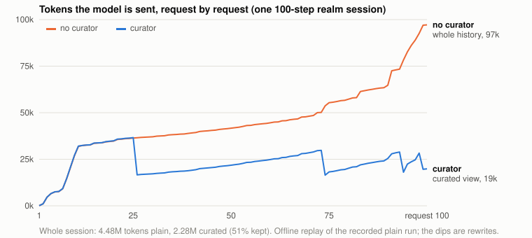
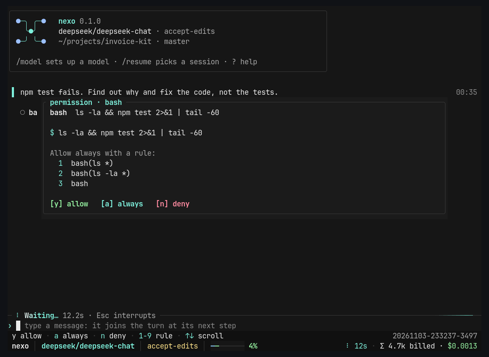

<div align="center">

# nexo

### The coding agent that doesn't run out of context.

**Every run solved. The lowest cost of the four.** Two heavy sessions, five runs, against compaction and the whole history.

[](https://github.com/Locotir/nexo/actions/workflows/ci.yml)
[](https://www.rust-lang.org)
[](LICENSE)
[](#install)
[](#any-provider)
[](https://www.paypal.me/locotir)



<sub>`marathon-heavy` and `marathon-noisy`, deepseek-flash, temperature 0. Every figure and its limits: [`docs/results.md`](docs/results.md).</sub>

```sh
cargo install --locked --git https://github.com/Locotir/nexo nexo-cli && nexo
```

</div>

## Why

Every coding agent re-sends its **whole history** on every call: step 80 pays again for the logs of step 3.
When the window fills it **compacts**: a summary replaces the work, the exact error line the model needed
is gone, and the prompt cache starts from zero.

nexo keeps the whole history on disk and sends the model a **curated view** of it, built by its context
curator for the next step only.

| | Whole history | Compaction | **nexo curator** |
|---|---|---|---|
| Tokens per call | grow every step | reset, then grow again | **stay small** |
| Prompt cache | hits, but you pay for everything | broken by each summary | **kept**: it cuts only when the saving pays for the rewrite |
| Old details | all there, buried | lost in a summary | **on disk**; the view says what left and how to read it back |
| Your rules ("never touch prod") | drift out of attention | can be summarised away | **pinned** for the whole session |
| A resumed session | same | starts from the summary | **same view as before**, cache still warm |

## The numbers

| Test | Result |
|---|---|
| **Two heavy sessions, four arms** (`marathon-heavy` ×3 and `marathon-noisy` ×2, deepseek-flash, temperature 0) | curator **5 of 5** at **\$0.207** a run; compaction at 200k 4 of 5 at \$0.239; whole history 4 of 5 at \$0.300; compaction at 100k 2 of 5 at \$0.337. Largest request: 105k against 198k to 222k |
| **A pasted-log session** (`marathon-pasted`, one run per arm) | curator solved it at \$0.769, compaction at 200k did not (\$0.628); a repeat of the curator did not solve it (\$0.348). Too few runs to call |
| **One 100-step session in nexo** (deepseek-chat, one run per arm) | **−36% cost**, **−59% wall time**, **−48% tokens** to the same point; both arms stopped at step 100 without solving the task (score 1% each) |
| Offline replay of the 7 recorded whole-history sessions in `nexo/crates/nexo-curator/tests/fixtures/` | **−26%** tokens sent in total (8.52M to 6.30M, estimated at 4 characters per token); per session from −49% to +7% |

Each run, request by request (ticks: each summary):





What the model is sent, request by request, replaying a recorded 81-request session through today's curator:



nexo as a coding agent on [Aider's Polyglot benchmark](https://github.com/Aider-AI/polyglot-benchmark)
(225 hard exercises in six languages, hidden tests, one retry that sees the failing tests), next to DeepSeek in Aider itself from [its public leaderboard](https://aider.chat/docs/leaderboards/):

<picture>
  <source media="(prefers-color-scheme: dark)" srcset="nexo/docs/polyglot-deepseek-dark.svg">
  
</picture>

Every figure, its data and its limits (mostly one model, one author's tasks):
[`docs/results.md`](docs/results.md). Measure it on your own tasks with [`nexo bench`](docs/usage.md).

## How the curator works


- **Squeeze at birth.** Progress bars, repeated lines and noise never enter the history.
- **One thread per goal.** A finished goal becomes a frozen card, so each goal keeps its cached prefix.
- **Cut in batches, only when it pays.** An economic-order-quantity rule: old material leaves when the
  tokens saved over the next requests outweigh one cache rewrite.
- **An anchor that never drops.** Your rules, the agent's notes, pinned files, a ledger of what left
  and a map of the work.
- **Stale reads go first.** A file read before the agent edited it leaves before anything else, with a
  note to read it again.
- **Cache pockets** (opt-in). Each topic keeps its own cached view, so coming back to a large piece of
  work after a switch reads it from the cache; how long the provider keeps it is learned from its replies.
- **Resume = same view.** Reopen or rewind a session and the curator replays its decisions, so the
  provider's cache still hits.

The engine, every setting and its default: [`docs/how-it-works.md`](docs/how-it-works.md). What the marks on each tool card mean (`● cached`, `● full price`, `◐ trimmed`, `○ set aside`, `↺ recalled`): [reading the screen](docs/how-it-works.md#reading-the-screen-the-mark-on-each-tool-card).
Why the context falls at every new message and climbs while the agent works, in diagrams: [`docs/context-curator.md`](docs/context-curator.md).

## Install

The scripts download the ready-built nexo from the [latest release](https://github.com/Locotir/nexo/releases/latest) (checked against its SHA-256) and put it on your PATH: `~/.local/bin` on Linux, `%LOCALAPPDATA%\Programs\nexo` on Windows. No Rust, no compiler, a few seconds. Where no ready-built file fits, they install what the build needs (Rust, a C compiler or the Visual Studio C++ build tools) and build it, no questions asked.

**Linux** (terminal):

```sh
curl -fsSL https://raw.githubusercontent.com/Locotir/nexo/main/install.sh | sh
```

**Windows** (PowerShell):

```powershell
irm https://raw.githubusercontent.com/Locotir/nexo/main/install.ps1 | iex
```

Or directly: `cargo install --locked --git https://github.com/Locotir/nexo nexo-cli`.

**Updates.** Each time it starts, nexo checks GitHub in the background and tells you when a newer release is out;
`nexo update` downloads it. `[ui] update_check = false` or `NEXO_NO_UPDATE_CHECK=1` turns it off.

Or from source:

```sh
git clone https://github.com/Locotir/nexo && cd nexo/nexo
cargo build --release            # target/release/nexo (nexo.exe on Windows)
install -m 755 target/release/nexo ~/.local/bin/   # or put target/release on your PATH
```

## Quick start

```sh
export DEEPSEEK_API_KEY=...      # or ANTHROPIC_API_KEY, OPENAI_API_KEY, GEMINI_API_KEY, ...
cd your/project
nexo                             # full-screen interface
nexo -p "run the tests and fix what fails"   # headless: prints the reply
nexo --continue                  # resume the latest session here
nexo doctor                      # checks files, provider, model and key with one live call
nexo --provider ollama --model qwen3:8b       # no key: a local model
```

The status bar shows what the curator is doing (`curator −62%`: sending 62% less than the whole history).
Pick a policy in `~/.nexo/config.toml`:

```toml
[context]
policy = "curator"               # auto | plain | compact | curator
```

## Everything else a coding agent needs


<sub>A real session with deepseek-chat: two bugs found and fixed, 4/4 tests passing, 6 steps, $0.0032.</sub>

- **Full-screen terminal UI**: mouse, folding transcript, search, command palette, diffs before every
  write, 16/256-colour, mono and `NO_COLOR` themes.
- **Headless mode** for scripts and CI: `nexo -p "..." --json`.
- **Tools**: read, write, edit, bash, glob, grep, ls, web search and fetch, todo list, language-server
  diagnostics after an edit.
- **Sub-agents** (read-only explorers or full workers, custom ones from `.nexo/agents/*.md`) and
  **background jobs**.
- **MCP servers**, **hooks** (`pre_tool` can block), **plan mode**, permission modes and remembered rules.
- **Undo and rewind**: go back to any message, and the files the agent wrote go back too.
- **Images**: attach them or paste a screenshot with `Ctrl+V`.

Before a command runs, nexo shows it and offers a rule to allow it from now on:



86 features, each with the test that checks it: [`nexo/FEATURES.md`](nexo/FEATURES.md).
Full guide: [`nexo/README.md`](nexo/README.md).

## Any provider

Bring your own API key. Built in: **Anthropic**, **OpenAI**, **Google Gemini**, **DeepSeek**, **xAI**,
**Groq**, **Mistral**, **OpenRouter**, Together, Fireworks, Cerebras, Moonshot, Qwen, Zhipu, MiniMax,
and local servers (**Ollama**, LM Studio, vLLM, llama.cpp). Over 200 more come from the
[models.dev](https://models.dev) directory, and any OpenAI- or Anthropic-compatible endpoint works.

## FAQ

**Can I use it with Claude?** Yes, with an Anthropic API key (`ANTHROPIC_API_KEY`). nexo has no sign-in
for a Claude.ai subscription.

**Can I use a subscription instead of a key?** `nexo auth login copilot`, `codex` (ChatGPT) and `xai`
(SuperGrok) run the vendor's own device sign-in: nexo shows a web address and a code, you approve on the
vendor's site, and the tokens stay in nexo's credential store on your machine. Whether your plan allows
use from a third-party tool is up to the vendor's terms: check them before you sign in.

**Does it still compact?** Only if you choose the `compact` policy, or as a last resort when a provider
rejects a request as too long. With the curator, the view stays far below the window.

**Where does my data go?** Only to the provider you pick, and to the web search backend or MCP servers when the agent uses them. Sessions live on your machine in
`~/.nexo/sessions/` and hold whatever passed through the conversation, so treat them like credentials.

**Is the saving real on my model?** It depends on the price of a cached token and on how long your
sessions are. `nexo bench` runs the same tasks with and without the curator and prints the difference.

## Support

nexo is free and MIT-licensed. If it saves you money, you can share a little of it:

[](https://www.paypal.me/locotir)

A star helps others find it. Issues and pull requests are welcome: see [CONTRIBUTING.md](CONTRIBUTING.md),
and report security problems privately as [SECURITY.md](SECURITY.md) explains.

## License

[MIT](LICENSE). nexo is an independent project, not affiliated with or endorsed by Anthropic, OpenAI,
Google, DeepSeek or any other provider. Product names are trademarks of their owners.

<sub>Keywords: AI coding agent, LLM agent harness, terminal coding assistant, Claude API, Anthropic API,
OpenAI API, DeepSeek API, Gemini API, context engineering, context window management, context
compression, prompt caching, token optimization, long-running agent sessions, Rust TUI, open-source
alternative to closed coding agents.</sub>
