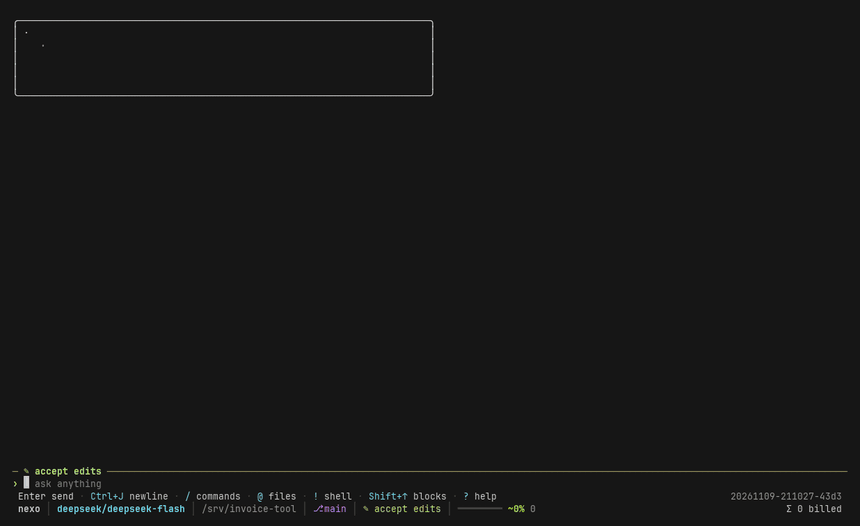
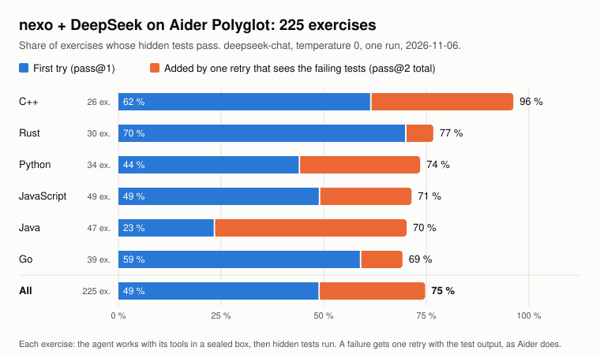
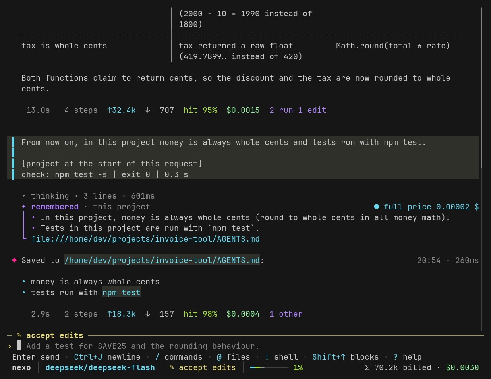

<div align="center">


# nexo

**The coding agent that doesn't run out of context.**

[](https://github.com/Locotir/nexo/actions/workflows/ci.yml)
[](https://www.rust-lang.org)
[](LICENSE)
[](#install)
[](#any-provider)
[](https://www.paypal.me/locotir)

</div>

nexo is a terminal coding agent written in Rust. It runs as a full-screen TUI that reads your codebase, edits
files, runs shell commands, searches the web and keeps long tasks on track: interactively, headless for scripts
and CI, or inside editors through the Agent Client Protocol (ACP). It works with any model provider, and its
context curator keeps long sessions small without summaries: the whole history stays on disk, and the model is
sent only what the next step needs.

[Install](#install) · [Why](#why) · [The numbers](#the-numbers) · [How the curator works](#how-the-curator-works) · [Any provider](#any-provider) · [Full documentation](nexo/README.md) · [Contributing](CONTRIBUTING.md) · [License](#license)

<p align="center"></p>


<sub>Live runs of `marathon-heavy` and `marathon-noisy`, deepseek-flash, temperature 0, 2026-11-04, on an earlier build (before epochs); the last live run of these four arms. Every figure and its limits: [`docs/results.md`](docs/results.md).</sub>

```sh
curl -fsSL https://raw.githubusercontent.com/Locotir/nexo/main/install.sh | sh
```

## Why

Every coding agent re-sends its **whole history** on every call: step 80 pays again for the logs of step 3.
When the window fills it **compacts**: a summary replaces the work, the exact error line the model needed
is gone, and the prompt cache starts from zero.

nexo keeps the whole history on disk and sends the model a **curated view** of it, built by its context
curator for the next step only.

| | Whole history | Compaction | **nexo curator** |
|---|---|---|---|
| Tokens per call | grow every step | reset, then grow again | **stay small** |
| Prompt cache | hits, but you pay for everything | broken by each summary | **kept**: the view is rewritten only at an epoch, when keeping its growth costs more than a new prefix |
| Old details | all there, buried | lost in a summary | **on disk**; the view says what left, and what a request names comes back by itself |
| Your rules ("never touch prod") | drift out of attention | can be summarised away | **pinned** for the whole session |
| A resumed session | same | starts from the summary | **same view as before**, cache still warm |

## The numbers

Every figure names its date and the nexo commit it was measured at. Where the commit is not public, the row says so.
The curator is held to not forgetting a fact the next call needs; cost comes second, so a cost that rises while
forgotten facts fall is kept on purpose.

**Scale, offline, no model** (`examples/scale.rs`, 1,000 topics with big pastes and questions that join facts across
topics; 2026-11-09, nexo `cdeb98a`). Recall is the share of questions whose needed lines are in the view; the compaction
arm summarises at 0.9 of the window. 1M never fills, so compaction there is the whole history.

| Window | Curator cost | Curator prefix equal to the last request | Curator recall | Compaction cost | Compaction recall |
|---|---|---|---|---|---|
| 8k | $0.91 | 98.4% | **100%** | $0.19 | 0% |
| 32k | $0.52 | 99.2% | **100%** | $0.34 | 0% |
| 128k | $0.59 | 99.4% | **100%** | $0.97 | 0% |
| 1M | $0.59 | 99.4% | **100%** | $2.41 | 100% |

Compaction is cheaper at small windows because it has forgotten what the questions ask for (0% recall). Price: DeepSeek's.
Replaying the 22 lab fixtures cold: 44 forgotten words, down from 93 and 125 earlier the same day, at 0.61 $ (up 2.9% from 0.59 $).

**Replay of the 7 whole-history sessions in `nexo/crates/nexo-curator/tests/fixtures/`** (2026-11-09, nexo `cdeb98a`, tokens
estimated at 4 characters each): **-19.6% tokens sent** (8.52M to 6.85M); per session from -37.0% to +6.8%. Priced with a
prefix cache at DeepSeek's cached rate, the input cost falls 2.1% (0.2874 $ to 0.2814 $): a view that waits for an
epoch saves tokens, not much money, on these sessions. The longest one, `bench-realm100-full`, costs 14% more.

What the model is sent, request by request, replaying a recorded 81-request session through the curator
(2026-11-09, nexo `cdeb98a`): 1.87M tokens against 2.97M (63% kept); ticks are epochs:


**Live, long sessions** (2026-11-04, an earlier build before epochs, `deepseek-flash`, temperature 0; these are the last live
runs of these arms and were not repeated):

| Test | Result |
|---|---|
| **Two heavy sessions, four arms** (`marathon-heavy` ×3 and `marathon-noisy` ×2) | curator **5 of 5** at **\$0.207** a run; compaction at 200k 4 of 5 at \$0.239; whole history 4 of 5 at \$0.300; compaction at 100k 2 of 5 at \$0.337. Largest request: 105k against 198k to 222k |
| **A pasted-log session** (`marathon-pasted`, one run per arm) | curator solved it at \$0.769, compaction at 200k did not (\$0.628); a repeat of the curator did not solve it (\$0.348). Too few runs to call |

Each run, request by request (ticks: each summary):


**Against other harnesses** (2026-11-09, `deepseek-flash`, nexo `b99d96c`, before epochs). Five harnesses on the same 16
Terminal-Bench tasks, one attempt per task. nexo solved 13 of 16 with its defaults and 11 of 16 with a 131k window; the
other four solved 12 to 14 in the same rounds. The 95% intervals overlap for every pair: it is a tie, not a ranking.
In round B the curator never acted, so this says nothing about its cutting. Method, all tables and caveats:
[`docs/results.md`](docs/results.md#harness-race-2026-11-09).

<picture>
  <source media="(prefers-color-scheme: dark)" srcset="docs/img/race-dark.svg">
  
</picture>

nexo as a coding agent on [Aider's Polyglot benchmark](https://github.com/Aider-AI/polyglot-benchmark)
(225 hard exercises in six languages, hidden tests, one retry that sees the failing tests), next to DeepSeek in Aider itself from [its public leaderboard](https://aider.chat/docs/leaderboards/).
nexo ran `deepseek-chat` once on 2026-11-06 with the `plain` arm (no curator), before a fix that stopped it keeping
replies cut at the token cap in its history; the commit is not recorded:

<picture>
  <source media="(prefers-color-scheme: dark)" srcset="nexo/docs/polyglot-deepseek-dark.svg">
  
</picture>

Every figure, its data and its limits (mostly one model, one author's tasks):
[`docs/results.md`](docs/results.md). Measure it on your own tasks with [`nexo bench`](docs/usage.md#the-benchmark-nexo-bench).

## How the curator works


- **Squeeze at birth.** Progress bars, repeated lines and noise never enter the history.
- **One thread per goal.** A finished goal becomes a frozen card, so each goal keeps its cached prefix.
- **Epochs.** The view is rewritten only at an epoch: once keeping its growth costs more than a new
  prefix, or at 95% of the model's window. Between two epochs it only grows at its end, so the provider's
  cache holds all of it but the newest request. After an epoch the step count starts again.
- **Closing priced by need.** When a request is answered, each tool step it made is kept or set aside by
  a learned guess of whether a later reply will draw on it (five horizons, 43 features, fit on 452
  recorded sessions) against the rent it costs to keep. Measured before epochs; see
  [`docs/results.md`](docs/results.md#the-need-predictor-and-the-hindsight-floor).
- **What a request names comes back.** An index of the history's lines by their keys: a file, a number or an
  id that your request names and the view no longer holds is brought back, or read back with `recall`.
- **An anchor that never drops.** Your rules, the agent's notes, pinned files, a ledger of what left
  and a map of the work.
- **Stale reads go first.** A file read before the agent edited it leaves before anything else, with a
  note to read it again.
- **Cache pockets** (opt-in). Each topic keeps its own cached view, so coming back to a large piece of
  work after a switch reads it from the cache; how long the provider keeps it is learned from its replies.
- **Resume = same view.** Reopen or rewind a session and the curator replays its decisions, so the
  provider's cache still hits.

The engine, every setting and its default: [`docs/how-it-works.md`](docs/how-it-works.md). What the marks on each tool card mean (`● cached`, `● full price`, `◐ trimmed`, `○ set aside`, `↺ recalled`): [reading the screen](docs/how-it-works.md#reading-the-screen-the-mark-on-each-tool-card).
Why the context falls at every new message and climbs while the agent works, in diagrams: [`docs/context-curator.md`](docs/context-curator.md).

## Install

The scripts download the ready-built nexo from the [latest release](https://github.com/Locotir/nexo/releases/latest) (checked against its SHA-256) and put it on your PATH: `~/.local/bin` on Linux, `%LOCALAPPDATA%\Programs\nexo` on Windows. No Rust, no compiler, a few seconds. Where no ready-built file fits, they install what the build needs (Rust, a C compiler or the Visual Studio C++ build tools) and build it, no questions asked.

**Linux** (terminal):

```sh
curl -fsSL https://raw.githubusercontent.com/Locotir/nexo/main/install.sh | sh
```

**Windows** (PowerShell):

```powershell
irm https://raw.githubusercontent.com/Locotir/nexo/main/install.ps1 | iex
```

Or directly: `cargo install --locked --git https://github.com/Locotir/nexo nexo-cli`.

**Updates.** Each time it starts, nexo checks GitHub in the background and tells you when a newer release is out;
`nexo update` downloads it. `[ui] update_check = false` or `NEXO_NO_UPDATE_CHECK=1` turns it off.

Or from source:

```sh
git clone https://github.com/Locotir/nexo && cd nexo/nexo
cargo build --release            # target/release/nexo (nexo.exe on Windows)
install -m 755 target/release/nexo ~/.local/bin/   # or put target/release on your PATH
```

## Quick start

```sh
export DEEPSEEK_API_KEY=...      # or ANTHROPIC_API_KEY, OPENAI_API_KEY, GEMINI_API_KEY, ...
cd your/project
nexo                             # full-screen interface
nexo -p "run the tests and fix what fails"   # headless: prints the reply
nexo --continue                  # resume the latest session here
nexo doctor                      # checks files, provider, model and key with one live call
nexo --provider ollama --model qwen3:8b       # no key: a local model
```

The status bar shows how full the context window is and what the session has cost; each tool card is marked
`● cached` or `● full price`, and `/context` says what the curator did. Pick a policy in `~/.nexo/config.toml`:

```toml
[context]
policy = "curator"               # auto | plain | compact | curator
```

## Everything else a coding agent needs


<sub>A real session on a throwaway project, deepseek-flash, nexo `cdeb98a`, 2026-11-09: two bugs found and fixed, 4/4 tests passing, 4 steps, $0.0015.</sub>

- **Full-screen terminal UI**: mouse, folding transcript, search, command palette, diffs before every
  write, 16/256-colour, mono and `NO_COLOR` themes.
- **Headless mode** for scripts and CI: `nexo -p "..." --json`.
- **Tools**: read, write, edit, bash, glob, grep, ls, web search and fetch, todo list, language-server
  diagnostics after an edit.
- **Sub-agents** (read-only explorers or full workers, custom ones from `.nexo/agents/*.md`) and
  **background jobs**.
- **[MCP servers](nexo/docs/MCP.md)** (`/mcp` shows them), **hooks** (`pre_tool` can block), **plan mode**, permission modes and remembered rules.
- **Undo and rewind**: go back to any message, and the files the agent wrote go back too.
- **Images**: attach them or paste a screenshot with `Ctrl+V`.
- **Goal, to-do list and changed files** in a side panel (`Ctrl+B`); `/goal` keeps working on a goal until it is
  done, and a click on the goal opens its window.
- **Saves its own rules.** Tell nexo how you work ("money is always whole cents") and its `note` tool writes the
  rule to your global or the project's instructions file. The transcript shows a `✦ remembered` card, and the
  file is a link you can Ctrl+click.
- **Queue and go**: type while it works; Enter on an empty draft sends the queued message now. One `read` call can
  take several files.

Before a command runs, nexo shows it and offers a rule to allow it from now on:


Say how you work once and nexo writes it down, so the next session starts with it:



105 features, each with the test that checks it: [`nexo/FEATURES.md`](nexo/FEATURES.md).
Full guide: [`nexo/README.md`](nexo/README.md).

## Any provider

Bring your own API key. Built in: **Anthropic**, **OpenAI**, **Google Gemini**, **DeepSeek**, **xAI**,
**Groq**, **Mistral**, **OpenRouter**, Together, Fireworks, Cerebras, Moonshot, Qwen, Zhipu, MiniMax,
and local servers (**Ollama**, LM Studio, vLLM, llama.cpp). Over 200 more come from the
[models.dev](https://models.dev) directory, and any OpenAI- or Anthropic-compatible endpoint works.

## FAQ

**Can I use it with Claude?** Yes, with an Anthropic API key (`ANTHROPIC_API_KEY`). nexo has no sign-in
for a Claude.ai subscription.

**Can I use a subscription instead of a key?** `nexo auth login copilot`, `codex` (ChatGPT) and `xai`
(SuperGrok) run the vendor's own device sign-in: nexo shows a web address and a code, you approve on the
vendor's site, and the tokens stay in nexo's credential store on your machine. Whether your plan allows
use from a third-party tool is up to the vendor's terms: check them before you sign in.

**Does it still compact?** Only if you choose the `compact` policy, or as a last resort when a provider
rejects a request as too long. With the curator, the view stays far below the window.

**Where does my data go?** Only to the provider you pick, and to the web search backend or MCP servers when the agent uses them. Sessions live on your machine in
`~/.nexo/sessions/` and hold whatever passed through the conversation, so treat them like credentials.

**Is the saving real on my model?** It depends on the price of a cached token and on how long your
sessions are. `nexo bench` runs the same tasks with and without the curator and prints the difference.

## Support

nexo is free and MIT-licensed. If it saves you money, you can share a little of it:

[](https://www.paypal.me/locotir)

A star helps others find it. Issues and pull requests are welcome: see [CONTRIBUTING.md](CONTRIBUTING.md),
and report security problems privately as [SECURITY.md](SECURITY.md) explains.

## License

[MIT](LICENSE). nexo is an independent project, not affiliated with or endorsed by Anthropic, OpenAI,
Google, DeepSeek or any other provider. Product names are trademarks of their owners.

<sub>Keywords: AI coding agent, LLM agent harness, terminal coding assistant, Claude API, Anthropic API,
OpenAI API, DeepSeek API, Gemini API, context engineering, context window management, context
compression, prompt caching, token optimization, long-running agent sessions, Rust TUI, open-source
alternative to closed coding agents.</sub>
