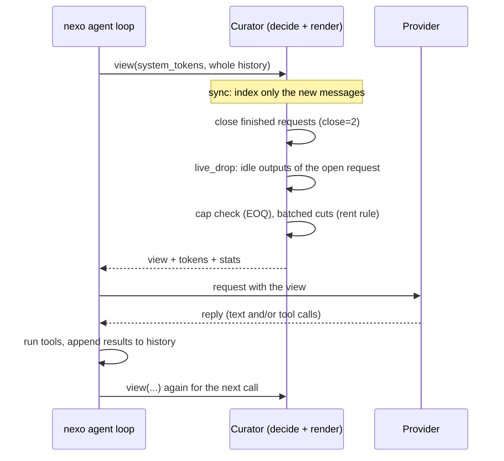
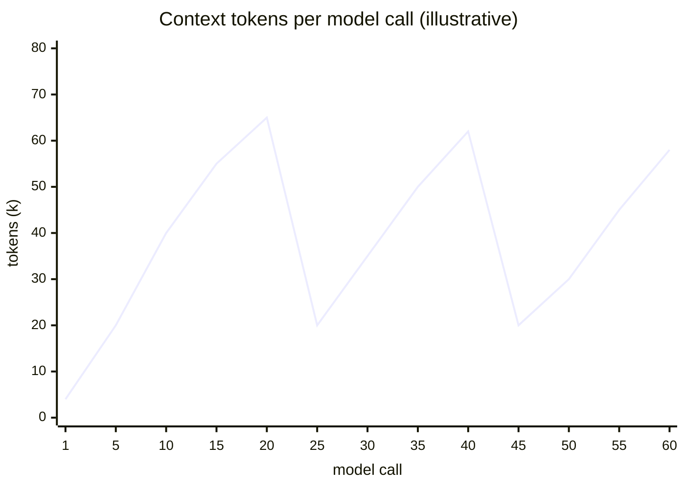
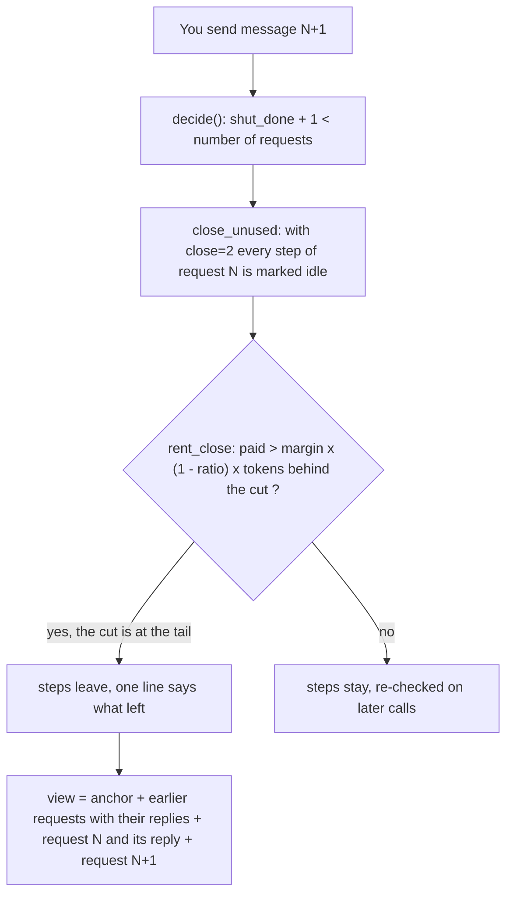

# Why the context drops at every new message

In the nexo TUI the context of a session looks like a sawtooth: it climbs while the agent works, falls at once when you send the next message, and climbs again. This is not a glitch, it is the curator working as designed. This page explains it from the code (`nexo/crates/nexo-curator`, driven by `nexo/crates/nexo-agent/src/context.rs`).

Numbers below are **illustrative** unless a constant is named. Constants are the defaults of `D_SPEC` in `lib.rs`.

## The short version

1. **The full history is never edited.** The curator only chooses the *view*, what the next model call is sent (`Curator::view` in `lib.rs`, called by `BuiltIn::view` in `context.rs` before every model call).
2. **Inside a request the view only grows at the end**, so the provider's cache keeps hitting. Cuts are rare and batched.
3. **When your next message arrives, the previous request is closed.** With `close=2` an answered request keeps only your message and the agent's final reply; its tool calls and outputs leave in one cut. That cut sits at the tail of the view, so it is cheap, and the rent rule approves it at once.

## One model call, step by step



Source: `Engine::sync` indexes new messages once, `Engine::decide` makes every decision, `Engine::render` builds the messages (`engine.rs`).

## Tokens per request across three user turns



```text
 k tokens
 65 |        /|                /|
 55 |      /  |              /  |                 /
 40 |    /    |   /         /   |   /           /
 20 |  /      |__/ ________/    |__/__________/
  4 |/        ^ turn 2 starts   ^ turn 3 starts
    +--------------------------------------------> model calls
      turn 1      turn 2             turn 3
```

Each fall is a request being closed. Each climb is the next request's calls and outputs being appended.

## Why it falls at the turn boundary



The rent rule (`rent_close`, `engine.rs`):

- **Keeping costs rent.** An idle step costs `ratio` of its tokens on every call: 0.1, or the model's cached read price over its uncached price when that is lower (0.02 for a 2 % cache). At the boundary the credit is `ratio x size x (since + ahead x calls)`, with `ahead=0.25`.
- **Cutting costs a purchase.** Everything after the cut is re-read without the cache once, `margin x (1 - ratio) x tokens behind the cut`, with `margin=2.25`.
- The cut is chosen with the largest gain. Because the closed request is the **last** thing before your new message, almost nothing sits behind the cut, so the price is small and the cut is approved in one batch.

Worked example (illustrative): request N made 12 steps totalling 45k tokens; 40 model calls so far. The credit is about `0.1 x 45000 x (0.25 x 40) = 45000`. The price is `2.25 x 0.9 x 1500 = 3000` (your new message and the protected tail). Gain is large, so all 45k leave.

## Why it climbs again inside a request

- **Append only.** New calls and outputs are added after what was already sent. The provider's cache covers the whole earlier prefix, so each call re-reads it at `ratio` of the price.
- **Cuts are batched.** The weighing runs only when `due`: every `check=4000` new tokens or `every=4` steps, and a cut is made only when it pays `margin` times (`decide`, `rent`).
- **The cap.** `eoq_cap` gives `cap = K + Q*`, with `K = eoq = 16000` and `Q* = sqrt(2 (1 - ratio) K g / ratio)`, where `g` is the growth in tokens per call measured in the session. For `g = 2000`: `Q* = 24000`, `cap = 40000`. Past the cap, the view is cut down to `floor x cap` and the anchor is rewritten.
- **Held outputs do not count toward the cap** (`held`, `still=32000`). Outputs the agent has not written about yet (no text, no note since) are what it is working from, and they leave only as exact copies of a later output, never on a guess, up to 32000 tokens. This is why a view can sit above the nominal cap during a long burst of reading, like the 65k in the picture.
- **Idle outputs of the open request** (`live_drop`, `live=1`): an output that no later agent message drew on goes idle and leaves when the same rent rule pays.

## What stays, what leaves, how to get it back

| Piece | At the turn boundary | How the agent gets it back |
|---|---|---|
| System prompt and tools | Stays (identical every call, cached) | n/a |
| Anchor (first message), with `[curator]` blocks: rules, notes, pins, ledger, map | Stays, rewritten only on a rewrite (cap) | It is always in view |
| Your messages | Stay, within the limits of `protect=12` and the cap | Folded into the ledger and the map only after a cap rewrite |
| The agent's final reply of each request | Stays (it is what the agent took from the work) | In view |
| Tool calls and outputs of a closed request | Leave (`close=2`), one line says which calls left | Run the call again, or `recall m00042` (see below) |
| A step the new request names or needs | Comes back as text (`recall` in `engine.rs`, picked by `named`, `asks`, `pick`) | Automatic |
| Other topics (threads) | One frozen card each, up to `cards=8` | Returning to the topic brings it back |
| Last 12 messages (`protect=12`) | Never cut by the cap | In view |

The line that replaces a closed request reads (`shut_lines`):

```text
[curator] 7 tool calls made for this request and their outputs are left out of this context:
<calls> . The reply that closed the request follows.
```

### The `m00042` names

Every message of the history gets the name `m` plus its 1-based index in five digits (`format!("m{:05}", mi + 1)`). When the host offers the `recall` tool, the line above also lists the output names, for example `The outputs are m00042, m00043; recall brings any of them back as it was`, and topic cards list their ranges (`m00010-m00031`).

Important default: the `recall` tool is offered unless the spec says `recall=0` (`BuiltIn::recall` returns `Curator::recall`, `offered` in `turn.rs`). With `recall=0` the names are not printed and the agent gets the data back by repeating the call or reading the file, as the line says.

## Cache friendliness

- A cut breaks the provider's cache **from the first changed message onward**. The engine counts this as `miss` and prices it before cutting (`Engine::miss`).
- That is why cuts are batched and placed late, and why `fresh=1`, `dedup`, `birth=squeeze` decide at birth rather than rewriting later.
- With `pockets=1` or `2` (off by default) the curator also models a provider that keeps several views alive, and learns how long from the cached-token usage the provider reports (`Curator::cached`).

## Nudges and cards, briefly

- **Nudge** (`nudge=0`, off by default): if on, after N steps without a `Finding:` or `Plan:` note the curator appends one request for notes to the last tool result, at most once per N steps (`Engine::nudge`). Notes survive in the anchor when the outputs leave.
- **Cards**: when the new request starts another topic, the old topic is frozen as one card (`cards_text`, `frozen`), which keeps its cached text stable.

## What I could not confirm from the code

- Exactly what makes up the ~20k floor in a given session. By the code it is the system prompt and tools, the anchor, earlier requests with their replies, the request just closed (request plus reply) and the new request. Whether the TUI counter includes the system prompt and tool definitions was not checked (`head_tokens` is tracked separately in `Curator`).
- How the `protect=12` tail interacts with `rent_close` at the turn boundary was not traced. The cap path (`eoq_cap`) excludes the tail from what a cut can take.
- The numbers in the diagrams and the worked example are illustrative, not measured.
