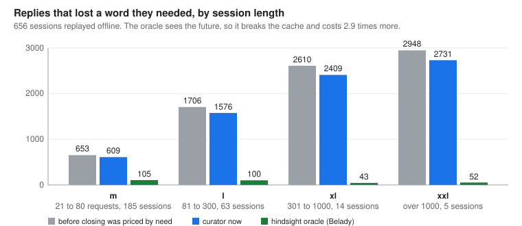

# Results

Status of every number: it names its date (2026-11-09 unless said) and the nexo commit it was measured at.
A number with no commit was measured before the commit log of this page began and is marked as such.
The numbers of 2026-11-09 were measured on `next` at the commits named in each table; the head of `next` when
this page was written is `cdeb98a`.

Nothing is claimed that is not in a table here. Where a figure comes from a lab log that is not in this
repository, the table says so and describes the method. Figures from the earlier implementation of the
curator (the thesis engine from which `nexo-curator` was ported, unpublished) are labelled as such.

## What the curator is held to

The design (see [`context-curator.md`](context-curator.md)) puts four things above cost: the curator is
never switched off, there is no sawtooth and no lossy summary, every fact the call needs goes into each
call, and the cache prefix stays stable. Not forgetting ranks above cost. The tables below are read
against that: a cost that rises while forgotten facts fall is kept on purpose.

| claim | status on 2026-11-09 | where |
|---|---|---|
| a recalled fact is in the call, at any history size tried | shown in cold tests: recall 100 % at 8k to 1M windows and 1,000 topics | [Cold scale](#cold-replay-and-scale-2026-11-09) |
| standing facts reach the calls that suppose them | shown in the same tests: 100 % | same |
| the prefix is stable | prefix equal to the previous request's in 98.4 to 99.4 % of the median call | same |
| the view stays under the window | shown: largest view 18.8k to 73.5k in the cold tests, windows from 8k up | same |
| it saves money against sending everything | shown in replay (-19.6 % of tokens on the public fixtures; in the 1,000-topic test 31.57M tokens and 0.5243 $ against 374.84M and 2.3404 $ for plain, my rerun); not shown live | [Replay](#replay-of-the-public-fixtures-2026-11-09), [Live](#live-paired-runs) |
| at the same success | not shown. The last live paired run (before epochs) failed its target | [Live](#live-paired-runs) |
| it beats other harnesses | not shown. In the race, all five arms are within 1 to 2 tasks and the intervals overlap | [Race](#harness-race-2026-11-09) |

## Cold replay and scale (2026-11-09)

**Method.** The cold tests need no model and no money. A recorded or generated session is fed to the curator
request by request, as the host does, and what the curator would have sent is scored.

- *Cold replay.* The 22 fixtures of the lab set (recorded and synthetic sessions; the public ones are in
  `nexo/crates/nexo-curator/tests/fixtures/`) replay through `examples/replay.rs` with the default spec.
  A shell script of the lab runs them all and sums the lines. Columns: the priced cost of the view, the
  number of forgotten words (distinctive words of a reply that the whole history held and the view did not),
  and the largest view. The script is not in this repository.
- *Cold scale.* `examples/scale.rs` in cold mode generates a session of N topics with big pastes and
  questions that correlate facts across topics, plants standing facts, and asks about them later. Columns:
  `recall` (share of questions whose needed lines are in the view, for questions of 1 fact and of 2 to 3
  facts), `fijos` (share of tasks that suppose a standing fact whose source line is in the view), view
  maximum, tokens sent, cost, `prefijo` (median share of each request's prefix equal to the previous
  request's, which is what a prefix cache reads), time per request. The model window is a flag.

Reproduce the scale line for 32k (from `nexo/`):
`cargo run --release -p nexo-curator --features sim --example scale -- --topics 1000 --hops 0 --seed 1 --window 32k`.
I ran it at `cdeb98a` on 2026-11-09: recall 100.0/100.0, fijos 100.0, view maximum 19,579 tokens,
31.57M tokens sent, 0.5243 $ at the example's DeepSeek price, prefix 99.2 %, 1.98 ms median and 25.92 ms p99
per request, 93 MB at most; the plain arm of the same session sends 374.84M tokens, 2.3404 $, with a
largest request of 310,702 tokens that does not fit 128k.

**Scale, 1,000 topics, by window** (lab log, nexo `79c506d`, `next` `cdeb98a`; the 32k line reproduced above):

| window | cost | prefix | recall (1 / 2-3 facts) | standing facts | largest view |
|---|---|---|---|---|---|
| 8k | 0.91 $ | 98.4 % | 100 / 100 % | 100 % | not recorded here |
| 32k | 0.52 $ | 99.2 % | 100 / 100 % | 100 % | 19.6k (my rerun) |
| 128k | 0.59 $ | 99.4 % | 100 / 100 % | 100 % | 18.8k |
| 1M | 0.59 $ | 99.4 % | 100 / 100 % | 100 % | not recorded here |

**Cold replay of 22 fixtures** (same commits): cost 0.6080 $, forgotten words 44, largest view 73.5k tokens.

**What moved these numbers today**, step by step (each from the lab log, in the order measured):

| change | commit | cold replay cost | forgotten | scale cost 8k / 32k / 128k / 1M |
|---|---|---|---|---|
| rewrite only at epochs, inflate one call | `cf3565c`, `c45cf94` | 0.5911 $ (from 0.6306) | 93 (from 125) | 32k 1.24 $, 128k and 1M 1.08 $ |
| epoch reset of steps, and a re-read by a shared file name only when the request names something of its own | `79c506d`, `cdeb98a` | 0.6080 $ (+2.86 %) | 44 | 0.91 / 0.52 / 0.59 / 0.59 $ |

Without the second fix, the same reset brought back about 200 steps per request when every folder held a
file called `service.conf`: the 128k scale cost 2.09 $ and the prefix at 8k fell to 16 %.
Open risks from the same log: the prefix at 32k, 128k and 1M is 0.1 to 0.2 points below the base and under
99.5 %; one synthetic fixture (`synthetic-g2-t40-s3`) forgot 28 words before the epochs and 51 after the
first epoch change, and was not re-checked after the later fix (Unknown); and three further planned rules
for inflating a view (i, ii and iv in the lab log) are not written, so only the rule in `tail.rs` exists.

**Speed** (lab log, `ae4b0bb`, before the epoch change, not repeated since): 10,000 topics, 84 ms median and
199 ms p99 per request; 1M tokens of history 20 ms and 501 ms; 10M tokens, p99 4.2 s. The 200 ms goal is not
met at 10M tokens: four loops that scan the whole history remain.

## Replay of the public fixtures (2026-11-09)

The 7 whole-history recordings `bench-*-full*.jsonl` replayed through the curator with its default spec at
`cdeb98a` (`examples/replay.rs`; tokens estimated at four characters per token; I ran every line today):

| fixture | requests | whole history | curator | change |
|---|---|---|---|---|
| `bench-realm100-full` | 100 | 3.53M | 3.48M | -1.5 % |
| `bench-marathon4-full` | 81 | 2.97M | 1.87M | -37.0 % |
| `bench-marathon-full` | 55 | 1.63M | 1.13M | -31.0 % |
| `bench-dir-full-4` | 22 | 204k | 187k | -8.3 % |
| `bench-long-full-1` | 21 | 152k | 155k | +1.8 % |
| `bench-results-full-4` | 5 | 21.7k | 21.7k | 0.0 % |
| `bench-results-full-0` | 8 | 6.0k | 6.4k | +6.8 % |
| **all** | | **8.52M** | **6.85M** | **-19.6 %** |

Every fixture shows `forgotten 0 words`. Reproduce one with
`cargo run --release -p nexo-curator --features sim --example replay -- crates/nexo-curator/tests/fixtures/<file>.jsonl --quiet`
(from `nexo/`; the `total over all requests` line). The replay cannot show how a model reacts to the view;
only a live run does. The previous version of this page, measured on an older build, read -26 % for the same files. The
smaller saving is probably because an epoch waits for the cost rule instead of cutting at each request
(Inferred, not isolated); what waiting bought is in the forgotten column above.

## Harness race (2026-11-09)

Five harnesses on the same 16 tasks (TB-MINI, a subset of Terminal-Bench), one model (`deepseek-flash`
through the DeepSeek API), one day. nexo was a static musl binary built from local `next` at `b99d96c`
(before the epoch change), `max_turns=40`, curator on with its defaults. The other arms were each
harness's own defaults in round A. Isolation: one Docker container per trial, Harbor 0.25.0, no shared
state; this is from Harbor's code and compose files, I did not inspect a live container. Cost uses one
price table for every arm (0.30 $ input, 0.006 $ cached input, 1.20 $ output per million tokens), not
each harness's cost field. The balance check found no trial excluded for an empty balance.

**Method.** Each task has exactly 1 valid attempt for every arm in each round (a valid attempt is one
where the agent really ran). Start failures (setup timeouts, a missing image) and extra attempts are
excluded and listed. nexo's 2 repetitions in round A gave 25/32 over 32 attempts; the table uses 1 attempt per
task for every arm so the arms are paired.

**Round A: defaults, 16 tasks, 1 attempt per task**

| arm | passed (Wilson 95 %) | mean steps | tokens in / cached / out | cache hit | cost | cost per solved task |
|---|---|---|---|---|---|---|
| nexo | 13/16 (57 to 93 %) | 16.1 | 5.94M / 5.72M / 308k | 96.4 % | 0.468 $ | 0.036 $ |
| Codex | 13/16 (57 to 93 %) | 18.4 | 11.91M / 11.62M / 354k | 97.6 % | 0.581 $ | 0.045 $ |
| Claude Code | 12/16 (51 to 90 %) | 18.4 | 11.14M / 10.80M / 346k | 96.9 % | 0.584 $ | 0.049 $ |
| Hermes | 12/16 (51 to 90 %) | 16.6 | 6.78M / 6.62M / 181k | 97.7 % | 0.305 $ | 0.025 $ |
| DeepSeek harness (dsh) | 13/16 (57 to 93 %) | 17.9 | 10.40M / 10.13M / 235k | 97.4 % | 0.425 $ | 0.033 $ |

**Round B: common window 131072, 16 tasks, 1 attempt per task**

| arm | passed (Wilson 95 %) | mean steps | tokens in / cached / out | cache hit | cost | cost per solved task |
|---|---|---|---|---|---|---|
| nexo | 11/16 (44 to 86 %) | 13.9 | 4.94M / 4.79M / 312k | 97.0 % | 0.448 $ | 0.041 $ |
| Codex | 14/16 (64 to 97 %) | 17.1 | 10.60M / 10.35M / 311k | 97.7 % | 0.509 $ | 0.036 $ |
| Claude Code | 12/16 (51 to 90 %) | 16.9 | 9.39M / 9.01M / 375k | 96.0 % | 0.617 $ | 0.051 $ |
| Hermes | 12/16 (51 to 90 %) | 14.4 | 6.60M / 6.40M / 192k | 97.0 % | 0.327 $ | 0.027 $ |
| dsh | 11/16 (44 to 86 %) | 17.3 | 8.10M / 7.79M / 257k | 96.2 % | 0.447 $ | 0.041 $ |

**Scored by cost on the common tasks.** The README ranks the arms by one rule: on the tasks every arm solved
(first solved attempt per task and arm), the winner uses the fewest steps, tokens and dollars together. The index is
the mean of (steps, tokens, cost), each divided by the best arm's value; 1.00 is best. Tokens are input plus output; cost
uses the price table above. Every arm solved 8 tasks in each round, and 5 (round A) and 6 (round B) of them are kept.

What was left out, and why. Reading the logs afterwards, I found that on some tasks an agent fetched the benchmark's own
published solution or test files from the internet and read them: all five arms on extract-elf in both rounds, nexo and
Claude Code on count-dataset-tokens in round A, Hermes on git-multibranch in round A, Claude Code on db-wal-recovery in round B
(14 trials, each checked in its log). The agents of every harness did it, nexo included. A task where any arm did so is
excluded for all arms, so the five arms stay paired on the same tasks: count-dataset-tokens, extract-elf and git-multibranch
in round A; db-wal-recovery and extract-elf in round B.

| arm | A: steps | tokens | cost | index | B: steps | tokens | cost | index |
|---|---|---|---|---|---|---|---|---|
| nexo | 42 | 0.97M | 0.092 $ | **1.18** | 58 | 0.83M | 0.052 $ | **1.04** |
| Hermes | 59 | 1.35M | 0.060 $ | 1.27 | 82 | 1.63M | 0.088 $ | 1.75 |
| Codex | 43 | 1.25M | 0.092 $ | 1.29 | 52 | 0.88M | 0.068 $ | 1.12 |
| dsh | 56 | 1.53M | 0.081 $ | 1.42 | 90 | 1.75M | 0.107 $ | 1.97 |
| Claude Code | 59 | 2.54M | 0.131 $ | 2.08 | 70 | 1.51M | 0.104 $ | 1.72 |

Round A tasks kept (5): circuit-fibsqrt, code-from-image, db-wal-recovery, fix-git, log-summary-date-ranges. Round B kept (6):
cancel-async-tasks, code-from-image, fix-git, git-multibranch, hf-model-inference, log-summary-date-ranges. Five or six tasks and
one attempt each: the index says which arm was cheapest on these, not which is better.

Before the exclusion (2026-11-09, 8 tasks per round): round A nexo 1.00, dsh 1.20, Hermes 1.37, Claude Code 1.57, Codex 1.78;
round B nexo 1.00, dsh 1.41, Hermes 1.44, Codex 1.54, Claude Code 1.80. The pass counts and the other tables on this page
cover all 16 tasks and are not changed.

**Reading it.** With 16 tasks the intervals overlap for every pair, in both rounds. The arms differ on
about 8 tasks, each with one attempt; adaptive-rejection-sampler fails for all five arms in both rounds and
configure-git-webserver for four of five in round A. This is a tie, not a ranking.

**In round B the curator never acted.** Its largest view was 25,936 tokens (25,777 in round A) against a
window of 131,072, and all 222 `curated` events of round B have empty `items`. So round B tells nothing
about the curator's cutting: nexo here is a harness with a stable prefix and short prompts (22k tokens per
call on average, against 39k for Codex), not a curator under pressure. Prompts of 22k to 39k tokens
are far below a 128k window, so the cap rarely had occasion to bite any arm (Inferred).

**Compactions seen in the logs.** nexo 0 and 0. Codex 0 and 0 (its window was verified at 124,518 in
round B against 258,400 in A). Claude Code 0 and 1 (one auto compaction in round B, from 99,364 tokens to
7,954, after which that trial failed). Hermes and dsh: the window setting was applied (131072 in the
config) but not observed, and no compaction event occurred.

**Failures by kind**, paired attempts, round A / round B. nexo: 2 exit errors and 1 wrong / 1 timeout, 2 exit
errors and 2 wrong. Codex: 3 wrong / 2 wrong. Claude Code: 2 exit errors and 2 wrong / 1 exit error and 3 wrong.
Hermes: 1 exit error, 1 timeout and 2 wrong / 2 timeouts and 2 wrong. dsh: 1 timeout and 2 wrong / 1 timeout and 4 wrong.
"Wrong" means the agent finished and the verifier scored 0.

**Excluded.** Start failures: 34 in round A (Claude Code 16 and Codex 11 of them from agent-setup
timeouts, none of which cost tokens) and 22 in round B (Claude Code 15, Codex 7); 21 extra valid attempts in
round A (nexo's second repetition, 16, and 5 of Codex's). The setup timeouts came from concurrent installs
and rate limits and were re-run with 3 times the timeout at lower concurrency.

**Session-ops (one long task, nexo only), same build.** Plain 1/2 solved, score 96.67 %, 40 steps, 0.1200 $;
curator 0/2 solved, score 90.00 %, 32 steps, 0.1145 $. No compaction or rewrite in either arm; largest view
68,002 and 65,306 tokens. One task: no conclusion about curator against plain.

**Cost of the race.** 5.3835 $ in all (5.149 $ for the 16-task rounds including extras and failures, 0.2345 $
for session-ops).

**Caveats.** The arms ran at the same time on one 14-core host with 3 trials each; wall times are not
comparable and are not reported, and timeouts may be load-sensitive. "Steps" come from each harness's
own log and are not exactly the same unit. nexo, Codex and Claude Code report input including cached
tokens; for Hermes and dsh the cached and cache-write tokens were added. One model, one day, 16 tasks, one
attempt: nothing here ranks the harnesses. To repeat it, run Harbor 0.25.0 with one container per trial on the
16 tasks: hf-model-inference, kv-store-grpc, chess-best-move, code-from-image, cancel-async-tasks,
count-dataset-tokens, circuit-fibsqrt, extract-elf, fix-git, git-multibranch, configure-git-webserver,
log-summary-date-ranges, db-wal-recovery, build-pmars, adaptive-rejection-sampler, largest-eigenval.

## Against Claude Code on the same model (2026-11-10)

`claude-sonnet-5-5` on both sides, nexo `bf57ed4`, 5 tasks, 3 runs each. Index of calls, tokens and dollars, 1.00 is best:
nexo 1.00, Claude Code 1.47; nexo cheaper in 15 of 15 pairs. Short sessions: the curator's eviction is not measured there.
Plan, tables, checks and limits: [`bench/RESULTS.md`](bench/RESULTS.md).

## Against Codex CLI on the same model (2026-11-10)

`gpt-5.6-luna` on both sides. One long session (10 turns, about 865,000 characters pasted): nexo solved it in 27 calls, Codex CLI did not (42 calls, 2 compactions). One run per tool. Results and limits: [`bench/CODEX.md`](bench/CODEX.md).

## Live paired runs

The last paid paired run of the curator against plain: `deepseek-flash`, nexo `575380d` (before the epoch
change), 2026-11-09, 5 tasks, stopped by its 4 $ budget at 12 of 19 repetitions (60 pairs, 4.002 $).
The target set for it (H1) is not met:

| measure | curator against plain | earlier paired run (H1-bis) |
|---|---|---|
| steps, ratio | 1.163 (plus or minus 0.080) | 0.992 (0.028) |
| cost | +36.8 % | -0.9 % |
| score | -6.67 points | -1.05 points |

All of it comes from one task, `vuln-hunt` (plain 8.2 steps and 0.92 score at 0.404 $; curator 19.2 steps and
0.58 at 0.877 $). The other four tasks sit at 0.85 to 1.05 times the steps with score 1.00 in both arms.
At the run's end the curator also had 59 `done` and 1 `max_steps` stops against 60 `done` and 1 budget stop
for plain. This run predates the cost rewrite, the 95 % ceiling, the index and the epochs; those were
measured only in the cold tests above. A live run with them is pending (Unknown).

## Theory: what a context is used for

The figures in this section and the next two were measured with the earlier implementation, on recorded
sessions, before 2026-11-09 (no commit; the exact date is not kept here). They are bounds and mechanisms,
not a description of today's tuning.

Once a session is over its future is known, so the ideal context at each step holds exactly what is
used then or later (the counterpart of Belady's optimal cache policy). Use is traced lexically: an
action uses a piece of context when it repeats one of its distinctive tokens (a path, a host, a version,
a long number, an identifier); names any model knows without being shown them are ignored. Replaying
recorded sessions under hindsight policies showed two things.

- **Tokens are not dollars.** With prompt caching, removing content rewrites the prefix and the rest is
  paid again. The eager oracle removes 56% of the tokens but saves only 15% of the cost, and
  provider-style tool-result clearing costs more than sending everything. *When* to cut matters as much
  as *what* to cut.
- **Choosing afresh at every request fails.** On the recorded sessions, with hindsight:

| clairvoyant policy | tokens sent (of everything) | saving |
|---|---|---|
| exactly what each request uses, chosen afresh, no care for the cache | 48% | **0.7%** |
| exactly what each model call uses, chosen afresh | 34% | 20.3% |
| dead content removed only when the cache allows it (dynamic programming) | 64% | 32.9% |
| floor: what each call uses, all of it already cached | – | 81.6% |

Three facts follow, and the design rests on them: removing from the end is free and from the middle is
not; every goal of a conversation can have its own cached prefix (the default `epoch=1` no longer
splits by goal); and within a goal the question is
"needed by this request", since what a later request needs can be appended then, where it costs least.

## Theory: where the optimisation stops

Measured with the earlier implementation on unseen recorded segments, 5-minute cache (no expiry in brackets):

| step | saving | what closes the gap | who can close it |
|---|---|---|---|
| sending everything | 0% | | |
| the earlier engine at its best (a 10k view with a ledger) | 61.5% (56.0%) | | |
| that engine with a perfect predictor of what comes back | 71.8% (67.4%) | foresight of *which* names: the ranking saturates at AUC 0.75 | nobody with the conversation alone |
| clairvoyant that quotes lines, sends what arrives whole | 81.6% (79.3%) | foresight of *when*: each line at the request that uses it | nobody without the next request |
| floor for that family | 84.0% (81.8%) | the prefix cache's last two points | the provider |
| clairvoyant that also cuts each block at arrival and pings (reachable) | 89.3% (88.1%) | foresight of what an arriving block will be needed for | nobody without the whole future |
| **ceiling, proved for every literal curator with the same calls** | **89.7% (88.6%)** | the relaxation's slack; NP-hard to pin exactly | nobody: the optimum lies in here |
| ceiling for any curator at all, summarising included | 91.0% (90.1%) | what a summary could save over a line, under the lexical measure | a different measure of need |
| 95% | | ×2.1 fewer calls even at the ceiling | the agent's work, not its context |

**The ceiling.** Under a prefix cache with read price `ρ`, any curator that sends literal text (whole
blocks or lines of them) and makes the same calls pays at least: the head at every request, the
structure of every message once, the output, and, for every block `b` used at requests `k₁ < k₂ < …`,
the least of `b` the first use needs plus, for every later use, the least it needs times `min(1, Σ w_r)`
over the requests in between (`w_r` is `ρ` while the cache is warm, and after a pause the cheaper of the
full price and the pings that would have kept it warm). Whatever is held of `b` at a use was either held
at every request since the previous use or re-sent in between, and the terms count different tokens, so
they add. The bound was checked against every clairvoyant curator on random sessions and by exhaustive
search on tiny ones. With the least text taken as the names themselves, the same proof bounds
summarising curators too: 91.0%.

**What is left is foresight.** Deciding what to hold in a bounded view is online paging, and every
deterministic online paging algorithm is at least `k`-competitive (Sleator and Tarjan, 1985); the rewrite
decision is rent or buy, where no deterministic rule beats a factor 2 (Karlin, Manasse, Rudolph and
Sleator, 1988). On those recordings the value of foresight was all-or-nothing per request, and in that engine no model
of any shape ranked the names better than its fixed rule (k-nearest neighbours 0.749, logistic
regression 0.736, the rule 0.775); nexo's shipped predictor ranks whole tool steps instead of names, on
more data, and does better (next section). Recalling,
just in time, lines that share a name with what has just arrived lost at every budget (unseen data,
61.8% without, 58.4% and 51.2% with 300 and 1,200 tokens per request).

**Time.** Fitted on 688 live DeepSeek requests (R² 0.94): 1.17 s + 0.023 s per 1k uncached + 0.008 s per
1k cached + 2.98 s per 1k output tokens. Input is 8–9% of the model's time, so with the same calls no
curator makes the agent more than ×1.09 faster (Amdahl); finishing sooner needs fewer calls and shorter
answers.

## The need predictor and the hindsight floor

These figures are from nexo (`nexo-curator` at the commit that added the predictor, before the epoch
rewrite of 2026-11-09), not from the earlier engine; the replay was not repeated since. The data is 656 nexo sessions recorded whole and replayed cold through the
curator with its default settings and a 40-step limit per request (`examples/replay.rs --bank`), split
by length: xs up to 5 requests (222 sessions), s up to 20 (167), m up to 80 (185), l up to 300 (63),
xl up to 1000 (14), xxl over 1000 (5). The recordings are not published. The measure of harm is a
**lost reply**: a reply of the recorded session that repeats a distinctive word which the curated view
no longer held at that call. The dollar figure prices every call at the cached and uncached rates the
recording was billed at.

**The predictor.** For every tool step (a call and its output) at every call of a session, hindsight
says whether a later reply drew on it within 1, 4, 16 or 64 calls, or ever. Five logistic heads, one per
horizon, are fit on 43 features of the step: size and age, the share of its words no later output
holds, whether the same file or program was read or run again and how that went, whether the open
request names it, whether its thread is active, who last held each of its words. Fit on 452 sessions
(364,786 step-call rows), tested on 204 other sessions (147,427 rows), split by file name so no session
is on both sides. At the 4-call horizon: log loss 0.205 (base rate 0.325; the heuristic it replaced
1.46), AUC 0.904 (0.824 for that heuristic). At the ever horizon: 0.290 and 0.896 (1.04 and 0.799). An
ablation puts half of the gain on the extra data and half on the last-holder features. The weights ship
in `nexo-curator/data/model.json`; `examples/needfit.rs` refits them.

**Closing priced by need.** The predictor enters the rent rule when a request is closed: a step is
worth its chance of reuse at the rent horizon times the price of the call that would bring it back,
and only steps worth less than their rent leave. Replies that lost a word, by class, before and after:

| class | sessions | before | after | change |
|---|---|---|---|---|
| xs | 222 | 0 | 0 | |
| s | 167 | 18 | 14 | |
| m | 185 | 653 | 609 | −6.7% |
| l | 63 | 1706 | 1576 | −7.6% |
| xl | 14 | 2610 | 2409 | −7.7% |
| xxl | 5 | 2948 | 2731 | −7.4% |

Cost over the sessions of more than 20 requests fell about 0.5%, tokens read without the cache about
2.8%, and the largest view in an xxl session from 290k to 182k tokens. On the 204 test sessions the
judged cost (dollars plus one call per lost reply) went from 21.68 to 21.22, better in 12 sessions and
worse in 8; the first step alone, a fixed price for every closed step, had given 20.95 to 20.49 on the
test sessions of more than 20 requests with a sign test at p = 0.032, and the heads on top of it moved
the judged cost by 0.01.

**Regret against hindsight.** On the test sessions with the view capped at half its default, the
number of steps dropped that a later reply then used is, per class, 1827 / 2356 / 2680 for the
predictor, the heuristic it replaced and plain first in, first out in m, against 928 for a Belady
oracle that keeps exactly the steps used later; 936 / 1279 / 1644 against 568 in l; 256 / 353 / 509
against 193 in xl; 72 / 173 / 174 against 42 in xxl. At a quarter of the cap the predictor is level with
the oracle in xl and xxl (505 against 540, 166 against 164).

## Earlier build: compaction against the curator

The long-session tables below were measured on 2026-11-04 on an earlier build of the curator (before epochs and the
ceiling; commit not recorded here). They are the last measurements of these four arms and the live
side of the comparison with compaction; they were not repeated.

### A heavy session: compaction at 100k and 200k against the curator

`marathon-heavy` (the marathon with twenty times the examples, so the history passes 200k tokens
without any policy), `deepseek-flash`, temperature 0, three runs per arm, `--max-steps 200`.

| arm | right | cost, mean (min to max) | steps, mean | largest view | compactions |
|---|---|---|---|---|---|
| plain | 3 of 3 | $0.305 (0.220 to 0.352) | 94 | 212k | 0 |
| compaction at 200k | 3 of 3 | $0.187 (0.182 to 0.197) | 72 | 144k | 0 |
| compaction at 100k | **1 of 3** | $0.340 (0.164 to 0.574) | 137 | 134k | 31 |
| **curator** | **3 of 3** | **$0.169 (0.112 to 0.216)** | 100 | **93k** | 0 |

Compaction at 100k lost the task twice. Once its summary dropped the list of tests that failed at the
start, which the last request asks for; once it summarised, read a large specification again, passed
100k again and summarised again, 28 times, until the step cap. Compaction at 200k never started: the
runs stayed under its limit, so it ran as plain with fewer steps. The curator was right in every run,
cheaper than plain in every run (−45% on the mean) and than compaction at 100k in every run; against
compaction at 200k the means differ by less than the runs do.

### A noisy session: the same four arms

`marathon-noisy` (the heavy marathon with a noisy build script and long CI logs), `deepseek-flash`,
temperature 0, two runs per arm, `--max-steps 200`. The second compaction-at-100k run is from a later
build (a third run of every arm was stopped by hand and is left out).

| arm | right | cost, mean (min to max) | largest request | summaries |
|---|---|---|---|---|
| plain | 1 of 2 | $0.292 (0.125 to 0.458) | 222k | 0 |
| compaction at 200k | 1 of 2 | $0.318 (0.241 to 0.395) | 198k | 1 |
| compaction at 100k | 1 of 2 | $0.332 (0.264 to 0.399) | 110k | 6 |
| **curator** | **2 of 2** | **$0.265 (0.137 to 0.392)** | **105k** | 0 |

### Both sessions together

Five runs per arm (three heavy, two noisy):

| arm | right | cost, mean |
|---|---|---|
| **curator** | **5 of 5** | **$0.207** |
| compaction at 200k | 4 of 5 | $0.239 |
| plain | 4 of 5 | $0.300 |
| compaction at 100k | 2 of 5 | $0.337 |

Five runs are few: the curator's lead in cost over compaction at 200k is smaller than the spread
between runs. What holds in every run is that it never lost the task and never sent more than 105k.

### A pasted-log session

`marathon-pasted` (the user pastes long logs into the messages), one run per arm. The curator solved
it ($0.769, largest request 213k); compaction at 200k did not ($0.628, three summaries). A second
curator run on a later build did not solve it ($0.348): the hidden test did not compile against the
interface it wrote. One run each cannot rank the arms; it is listed so no result is left out.

## Threats to validity

- **One project, one person.** The recorded data is this project's own development plus synthetic
  sessions written by its author.
- **One model, few runs.** The live tests use DeepSeek models on tasks written by the author, or on a
  public subset of 16 tasks with one attempt. The intervals say what separates from zero.
- **A lexical measure.** A need is a name that appears in the next action; influence without copying is
  not counted. Token figures in replays are estimated at four characters per token, low by a median factor
  of 1.22 against DeepSeek's counts in the earlier engine's measurement; dollar figures of live runs use
  the server's own counts.
- **Cold tests are generated.** The scale session is synthetic: it shows that facts reach the call and the
  prefix holds, not how a model answers with them.
- **Comparisons within one run.** The code moved while it was measured, so only candidates run together,
  on the same data, are compared. The race binary predates the epoch change.
