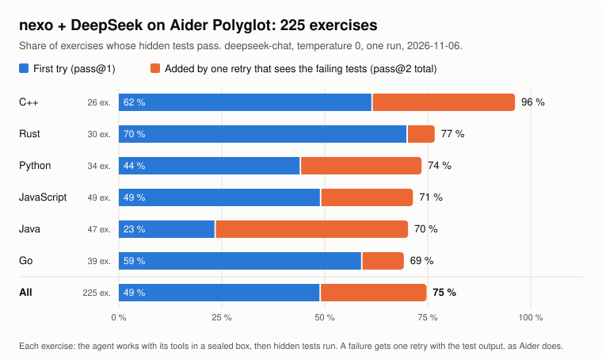

# nexo

A terminal coding harness for any model provider: a full-screen interface
(mouse, folding transcript, search, palette) and a headless mode, with tools
(read, edit, write, shell, search), permissions, sessions, MCP servers, and
a built-in context curator as its default context policy.
Written in Rust (ratatui), for Linux and Windows (both built and tested on every push; macOS is not tested).



Everything it does, and the test that checks each thing: [FEATURES.md](FEATURES.md).

## Install

**Linux** (terminal):

```sh
curl -fsSL https://raw.githubusercontent.com/Locotir/nexo/main/install.sh | sh
```

**Windows** (PowerShell):

```powershell
irm https://raw.githubusercontent.com/Locotir/nexo/main/install.ps1 | iex
```

Both download the ready-built binary from the [latest release](https://github.com/Locotir/nexo/releases/latest)
(Linux and Windows, x86_64 and ARM; checked against its SHA-256 list) into `~/.local/bin` or
`%LOCALAPPDATA%\Programs\nexo` and add that folder to PATH. Where no binary fits, or with `NEXO_BUILD=1`,
they install what a build needs (Rust, a C compiler or the Visual Studio C++ build tools) and build from
source. `NEXO_INSTALL_DIR` picks another folder.

`nexo update` replaces nexo with the latest release (it builds from source when none fits);
`nexo update --check` only says. The interface also checks in the background at start:
`[ui] update_check = false` or `NEXO_NO_UPDATE_CHECK=1` turns that off.

From a clone (Rust 1.89 or newer):

```sh
cd nexo
cargo build --release          # target/release/nexo (target\release\nexo.exe on Windows)
install -m 755 target/release/nexo ~/.local/bin/
```

Linux and Windows are built and tested on every push; macOS is not. On Windows, settings and sessions
live in `%USERPROFILE%\.nexo`, commands run in Git Bash when Git for Windows is installed (else
PowerShell; `/status` shows which), and keys typed in `/model` go to `%USERPROFILE%\.nexo\keys\<name>`.

## Start

```sh
export DEEPSEEK_API_KEY=...     # or OPENAI_API_KEY, GEMINI_API_KEY, XAI_API_KEY, GROQ_API_KEY, ...
cd your/project
nexo                            # picks the first provider whose key is present
nexo --provider openai --model gpt-5
nexo "fix the failing test"     # opens the session and sends this first
nexo -i shot.png "why is this red?"   # attaches an image to that first request (also with -p)
nexo -p "what does this repository do?"            # headless: prints the reply
nexo -p "run the tests and fix what fails" --permission-mode yolo --json
nexo --continue                 # resume the latest session of this directory
nexo --yolo                     # never ask for permission (also /yolo inside)
nexo --sandbox workspace-write   # bash runs in an OS sandbox: reads everywhere, writes the project only (also /sandbox)
nexo prompt                     # print the system prompt as it would be sent from here
printf %s "$KEY" | nexo bench --upstream URL --model M --key - --out bench-out   # measure the context policies
```

Local servers need no key: `nexo --provider ollama --model qwen3:8b`.
With a subscription instead of a key: `nexo auth login copilot` (or `codex`
for ChatGPT Plus/Pro: it reuses the Codex CLI login if there is one, else
opens the browser; `/model` offers the same), then `nexo use copilot`. `nexo doctor` checks the
setup, and `nexo guide` prints the step-by-step guide
([`docs/SETUP-FOR-AGENTS.md`](docs/SETUP-FOR-AGENTS.md)), which an assistant
can follow to set nexo up for you.

More launch flags: `--cwd DIR`, `-w [NAME]` (work in a new git worktree on `nexo/<name>`, kept if it changed), `--theme NAME`, `--no-mouse`, `--no-alt-screen` (keep the session in the scrollback), `--inline` (finished turns go to the terminal's scrollback), `--context POLICY` (`NEXO_CONTEXT`), `--log FILE`. Other commands:

| Command | What it does |
|---|---|
| `nexo sessions [rename\|delete\|restore]` | list, name, trash and bring back sessions |
| `nexo export` | write a session as HTML, markdown or JSON, keys and tokens removed |
| `nexo review` | review the current diff for CI (see Git commands) |
| `nexo mcp`, `nexo plugin`, `nexo worktree` | MCP servers, plugins ([docs/PLUGINS.md](docs/PLUGINS.md)), the worktrees nexo made ([docs/WORKTREES.md](docs/WORKTREES.md)) |
| `nexo audit` | the local audit log of tool calls and requests ([docs/AUDIT.md](docs/AUDIT.md)) |
| `nexo supervise` | watch long-running sessions and answer their hooks |
| `nexo acp` | run as an Agent Client Protocol server for editors ([docs/ACP.md](docs/ACP.md)) |

## In the interface

The keys sit on the top line; the **status bar** is the bottom line, right under the draft. It shows the model, the effort, the permission mode (coloured: `yolo` in red), the git branch, a thin line gauge (`━━━╸━━━━ 42%`) for what the last call sent against the model's window (yellow, orange, red as it nears), and the whole history kept (`session 1.2M tok`), so the gap between the two is the saving of the context policy. On the right, `Σ 6.5k billed` adds up the tokens of every call so far (each call re-sends its context, so it grows much faster than the history, and the cost next to it is paid on it), `81% cached` is the share of input the cache served (green from 50%), `12 calls` the calls so far and `⏱ 14s` the running turn. `/context` prints all of them.


| Keys | What |
|---|---|
| `Enter` / `Ctrl+J` | send / newline |
| `Enter` on an empty box while a request waits in the queue | interrupt the turn and run the queued request now |
| `↑` on an empty box while requests wait in the queue | take the last queued request back into the box to edit it (click a queued row for any other) |
| `Esc` | interrupt the turn; again: clear the draft |
| `Ctrl+C` ×2, `Ctrl+D` (empty draft) | quit |
| wheel, `PgUp`/`PgDn`, `Home`/`End` | scroll the transcript (it glides there) |
| scrollbar | drag the thumb, or click the track to jump; it lights up under the pointer, in every window and picker too. While you read further up, `↓ N new` (click it) and the thumb pulse when more arrives |
| click on a block | select it; a click on the first line of the selected block folds or opens it (a drag still selects text) |
| `Shift+↑` or `Tab` (empty draft) | select the last block: a tool call with its result, thinking, a reply or message of several lines |
| `↑`/`↓` (a block selected) | the previous / next block, the view following it; `↓` past the last goes back to the draft |
| `→` / `←` / `Enter` (a block selected) | open / fold / toggle it; `Esc` or typing lets it go |
| `→` / `←` on a message, double click | your message shows only what you typed. The dim line under it, `+ nexo added · N tokens (start note, 2 files, hook…)`, says what nexo put around your words (hook context, shared memory, the start note, attached files, MCP resources; a supervisor note is marked `this request only`); `→` or a double click opens it to the exact text (long files cut with `… N more lines`), `←` or another double click folds it. Resumed sessions show the same, found again by their markers |
| `/sent` (`/request`) | a window with the last request as the model got it: the system prompt by parts, the tools offered, then every message by role, the curator's text marked `[curator]`, a token count per section; `/` searches, `n`/`N` step, `y` copies the section, `e` opens a folded one |
| `Ctrl+O` | fold or open every tool group, tool card and thinking block |
| `Ctrl+T` | show or hide the model's reasoning |
| `Ctrl+P` | interpreted view: a markdown, JSON, CSV or TSV block (and a `.md`/`.json`/`.csv` file a tool read or wrote) shows rendered instead of as source; again: the source |
| `Shift+Tab` (no block selected) | permission mode: ask → accept-edits → plan → ask |
| `Ctrl+F`, `n`/`N` | search the transcript |
| `Ctrl+Y` | copy the last reply |
| `Ctrl+V` | paste: an image in the clipboard (a screenshot) is kept as a PNG and attached to the next request; text is pasted as text |
| drop an image | a PNG, JPEG, GIF or WebP dragged onto the terminal arrives as its path and is attached as an image |
| `Ctrl+G` | write the draft in `$EDITOR`; it comes back to the box |
| `↑`/`↓` (no block selected), `Ctrl+R` | the requests sent before (kept between runs in `~/.nexo/prompt-history.jsonl`); `Ctrl+R` searches them |
| drag with the mouse | select text; copied when the button comes up (`Shift`+drag: the terminal's own selection; `/settings mouse` turns capture off) |
| `Esc` `Esc` (empty draft, idle) | rewind to before an earlier message and edit it; the files the agent wrote since are put back |
| `Ctrl+B` | the side panel: goal, todo list, changed files |
| `F3` | list what the curator added to a model call (again: the call before) |
| `F4`, `/diff` | the side diff panel (selected edit, else the latest); `/diff` opens the diff viewer |
| `Ctrl+L` | redraw the screen |
| `F1`, `?` (empty draft) | the key help; `[ui.keys]` remaps `search`, `help`, `files` and the other actions (`search = "ctrl+s"`) |
| `/`, `Ctrl+Space`, `Alt+P` | command palette; every command answers to its aliases too (`/sessions` is `/resume`, `/back` is `/rewind`, `/q` is `/quit`). The list: `/help` |
| `@` | attach a file (fuzzy picker over the project); an image (`png`, `jpg`, `gif`, `webp`, up to 5 MB) goes as an image for models that see |
| `!cmd` | run a shell command without a model call |

While the agent works, the line above the editor says what it does (`⠴ Editing… 12s · ↓ 1.3k tok · Esc interrupts`),
with a light sweeping across the word; the reply grows behind a blinking caret. A turn that took 15 s or more
rings the terminal's bell when it ends, with a desktop notification where the terminal takes one (OSC 9/777):
`[ui] notify_after = 0` turns it off.

The status bar answers clicks: the model opens the model picker, the effort `/effort`, the permission mode its picker, the gauge `/context`, the cost `/usage`, `◎ goal` the goal window (your words and the restatement, round, state, time, spend and each interruption with its reason; `r` or Resume goes on). On the keys row, `todo d/t` opens `/todo`, `⚙ N jobs` `/jobs`, `⊕ mem` the shared memory that waits (`/memory share list`), `◷ N queued` `/queue` and the session name `/resume`. Each is underlined under the pointer; `Esc` closes the list.

The **Usage** tab of `/usage` ends with "What's contributing to your usage?": nexo reads the sessions saved on this machine and ranks what cost the most as a percentage, each row with one change under it (calls over 150k tokens of context, cache misses, tool output re-sent most, spend by model and project, history the curator left out), then a table of the biggest sessions. `d`, `w` and `m` pick today, 7 days or 30. Shares overlap, so they do not add up to 100%.

Motion (smooth scroll, fades, the glow under a working agent) is off with `[ui] animations = false`. Messages carry a dim `HH:MM` and replies their duration; `[ui] timestamps = false` or `/settings timestamps` hides them.

A run of two or more tool calls (thinking in between counts) is one line while it is folded: `Made 1 edit +29 −3, read 2 files, ran 3 shell commands · 1 failed  4.2s ▸`. It reads in the present tense with a live clock while a call runs (the running call stays in view) and folds by itself once all have finished. Select it with the arrows or click it, then Enter or → opens it; `Ctrl+O` opens or folds all of them. `[ui] group_tools = false` shows every call on its own line again.

While you type, the rest of a word seen anywhere in the session (your messages, replies, tool arguments and output) shows in grey after the cursor: words in any language, names, paths (and each part of them), flags, URLs, hashes. `→` at the end of the word takes it; with a block picked or the command list open the arrows keep their meaning. Secrets (values after key/token/password, `sk-` style keys) are never offered. `[ui] complete_words = false` turns it off.

When a turn ends, a dim guess at your next message shows in the empty input; `Tab` or `→` takes it whole, typing hides it. It costs one short cached side request that never enters the history, runs no tools and fires no hooks, and is never made in headless or ACP runs. `[ui] suggest = false` turns it off ([docs/SUGGESTIONS.md](docs/SUGGESTIONS.md)).

**Spend limits.** `[agent] max_cost = 1.0` stops a session at a dollar; `max_cost_day = 5.0` stops every
session together for the day (what was spent each day is in `~/.nexo/spend.json`). Past 80% nexo
warns once; at the limit the request stops before the model is called, so a limit is passed by one call at
most. The status bar shows the spending against the limit (`$0.4200/1.00`, orange near it, red at it).
`/budget` says what this session and today cost; `/budget 2` sets this session's limit, `/budget off` lifts it.

```toml
[agent]
max_cost = 1.0       # dollars per session
max_cost_day = 5.0   # dollars per day, all sessions
```

Other `[agent]` keys:

| Key | Default | What |
|---|---|---|
| `reasoning_budget` | `8000` | tokens a reply may reason before it says or calls anything; past it the reply is cut and asked again (`0` off; skipped when an effort level is set) |
| `parallel_tasks` | `true` | `false` runs sub-agents that can change files one after another |
| `subagents` | `true` | `false` removes the `task` tool |
| `subagent_brief`, `subagent_brief_engine` | `3000`, `auto` | the briefing a sub-agent gets (see below) |
| `system_prompt_file`, `system_prompt_extra` | none | another system prompt file; text appended to it |

**Coming from another coding agent.** What a team already keeps for Claude Code or Codex CLI works on day one:

- Instructions: `AGENTS.md`, `CLAUDE.md` (also `.claude/CLAUDE.md`) and `CLAUDE.local.md` in the project folders (from
  where you are up to the repository root; your home folder only when you work in it and it is a real repository), nearest first; `AGENTS.md` wins over `CLAUDE.md` in the same folder, `NEXO.md` comes before both. A word like `@docs/style.md`
  places that file (relative path, up to 5 levels, no cycles, never a key file) after its line. Instruction files in
  folders you are not working in are listed, to be read when you work there. For you: `~/.nexo/NEXO.md` or `AGENTS.md`,
  and only when neither exists `~/.codex/AGENTS.md` and `~/.claude/CLAUDE.md`, sent as background notes written for
  another agent (up to 4,000 characters), never as a request. A resumed session gets the files as they are now.
- Commands: `.claude/commands/**/*.md` (`git/sync.md` is `/git:sync`) and `.codex/prompts/*.md`, in the project (once
  trusted) and in your home. `description:` and `argument-hint:` show in the palette; `$ARGUMENTS` and `$1` to `$9`
  are filled in; `allowed-tools:` is read but not enforced. A command in nexo's own folders wins on a name clash.
- Sub-agents: `.claude/agents/*.md` (`name`, `description`, `tools`, `model`), tool names mapped (`Read` to `read`,
  `Bash` to `bash`...). A model nexo's provider does not offer, or `inherit`, uses the current model.
- `/status` lists where each came from. `NEXO_COMPAT_HOME` points the home lookup elsewhere (empty: off); a custom
  `NEXO_CONFIG_DIR` also turns off the other tools' home folders.
- Not wanted: `[compat] claude_code = false` in `~/.nexo/config.toml` makes nexo ignore every Claude Code source:
  `~/.claude/CLAUDE.md`, `~/.claude` commands, agents and skills, and in a project `CLAUDE.md`, `CLAUDE.local.md`,
  `.claude/CLAUDE.md`, `.claude/commands`, `.claude/agents`, `.claude/skills` and the hooks of `.claude/settings.json`.
  Codex's files and nexo's own are read as before. Default `true`.

**Commands of your own.** A markdown file in `~/.nexo/commands/` or in the project's `.nexo/commands/`
(once the project is trusted: `nexo config trust`) is a command named after it: `.nexo/commands/review.md` is `/review`. Its text is sent as the request, with
`$ARGUMENTS` replaced by what follows the name (appended when there is no `$ARGUMENTS`). The palette lists them
after the built-in ones, with the `description:` of a front matter block or the file's first line:

```markdown
---
description: review the change against our rules
---
Review $ARGUMENTS against CONTRIBUTING.md and list what breaks a rule.
```

**Agent Skills.** A folder with a `SKILL.md` (front matter `name`, `description`, optional `allowed-tools`)
and any files it mentions is a skill, the same format Claude Code and Codex use. nexo looks in
`.nexo/skills`, `.agents/skills` and `.claude/skills` of the project (the working directory up to the
repository root), then in `~/.nexo/skills`, `~/.agents/skills` and `~/.claude/skills`; on a name clash the
first wins, nexo's own folders first. The model sees each skill's name and a short description (up to
100, fixed for the session so the prompt cache holds) and loads the body with the `skill` tool when a
task matches. Run one yourself with `/skill-name [args]`; `/skills` lists what was found and where from.
`allowed-tools` is shown but not enforced: the permission rules still decide. Project skills are read like
`AGENTS.md`, without the trust step that commands and agents need.

**Sub-agents.** The model has a `task` tool: it hands a self-contained job to a sub-agent that works on
its own and answers with a short report. Only the report enters the conversation, so a wide search costs
one message. Two kinds come built in:

| Kind | Can do | For |
|---|---|---|
| `explore` (default) | read, grep, glob, ls, web search; nothing outside the project | "where is X handled?", "what calls Y?" |
| `general` | every tool but `task`; writes and commands ask the same permission as the main agent | a self-contained change or check |

Several `task` calls in one message run at once, also `general` ones that change files: a file one of
them is changing is closed to the others until it ends, and the one turned away says so in its report
(`[agent] parallel_tasks = false` runs those that can change files one after another). A sub-agent's spending is added to the session's. Your own kinds go in
`~/.nexo/agents/<name>.md` or `.nexo/agents/<name>.md` (the project's wins over a built-in of the
same name, and is read once the project is trusted):

```markdown
---
description: reviews a diff for bugs
tools: [read, grep, glob]
model: deepseek-chat
rounds: 20
---
Read the change and list what is wrong with it, worst first.
```

`[agent] subagents = false` removes the tool.

**The briefing.** A sub-agent does not start blind. Before it runs, nexo (not the model) picks from the
conversation what bears on its task and puts it ahead of the task, at most `[agent] subagent_brief` tokens
(3000; `0` turns it off): the facts (the latest request, rules given earlier, files read and written with a
read marked `current` while it matches the disk, commands still failing, the todo plan) and excerpts of tool
outputs and messages that hold the task's words, picked by the curator's selection
(`subagent_brief_engine = "auto"` or `"curator"`) or by word overlap alone (`"lexical"`). The same conversation
and task give the same briefing. The sub-agent is told not to read again what is marked current, and its
report comes back cut at about 2000 tokens. A line says what it was handed: `briefed: 2.1k tok, 6 spans, 5
facts · curator`. `nexo brief SESSION|FILE TASK…` prints the briefing a task would get (`--tokens`,
`--engine`, `--json`).

Measured on a recorded session of 26 sub-agents, a briefing averages 3.1k tokens, takes about 0.1 s for a 300k-token parent, and is read from the cache after its first call: it pays for itself when it spares two or three calls. The sub-agent got the files it needs more often than from the last 3000 tokens (25% against 15%) but less than from the whole parent conversation (53%).

**Background work.** `bash` with `background: true` starts a command (a server, a watcher, a long build) and
returns at once with its job id; `task` with `background: true` does the same for a sub-agent that changes
nothing (one that can change files runs in the foreground, so it never edits beside another). The model goes
on with its work and uses the `jobs` tool to list jobs, read new output (optionally waiting for it) or kill
one. When a job ends, the model is told once, and if it was idle it wakes up to look. `/jobs` opens a window with them and the end of their output,
`/jobs kill [id]` stops one (or all), and the status line shows `⚙ N jobs` while any runs. In a `-p` run,
jobs still running when the model finishes are stopped. `bash` with `background: true, detach: true` is for a
service that must keep running after the task and after nexo exits: it starts in its own session (no console
on Windows), its output goes to a log file under the temp directory, and the result gives the log path and the
pid to stop it with. It is not a job (`jobs` does not list it, exit does not stop it), asks for the same approval
as any `bash` command and runs inside the OS sandbox when that is on.

**Language servers.** The `diagnostics` tool asks the file's language server (rust-analyzer, pyright or pylsp,
typescript-language-server, gopls, clangd; whichever is installed) what is wrong after an edit. It starts
the server with build scripts, proc macros and check on save off, so it does not run the project's code;
read-only sub-agents do not get it.

**Hooks.** Shell commands at points of the loop, each given the event as JSON on stdin and `NEXO_EVENT`,
`NEXO_TOOL`, `NEXO_CWD` in its environment. A `pre_tool` hook that exits with 2 blocks the call, and what
it printed is the reason the model reads; `post_tool` and `turn_end` hooks are told what happened.
Twelve events in all (session, prompt, tool, stop, sub-agent, compaction, notification, permission, turn end), JSON
decisions, `matcher` regexes, `timeout`, and a trusted project's `.claude/settings.json` hooks: see
[docs/HOOKS.md](docs/HOOKS.md). `/hooks` lists what is loaded.

```toml
[[hooks]]
event = "pre_tool"
matcher = "bash"                       # a tool, `edit|write`, `web_*`; none: every tool
command = "grep -q 'git push' && { echo 'no pushes from here' >&2; exit 2; } || exit 0"

[[hooks]]
event = "post_tool"
matcher = "edit|write"
command = "cargo fmt >/dev/null 2>&1 || true"
```

**Vim keys.** `/settings vim` (or `[ui] vim = true`) gives the editor vim's modes: `Esc` to normal mode
(`h j k l w b e 0 $ gg G x X D C dd cc u p`, `i a A I o O` back to typing, `Enter` sends), the mode shown
by the mark (`›` typing, `▪` normal) and in the hint bar.

**Undo.** Before the agent writes a file, nexo keeps what it looked like. `/undo` takes back the last request:
its messages go, the files it wrote are put back (a file it created is removed), and the request returns to the
editor to be changed and sent again. A rewind to an earlier message (`/rewind`, `Esc Esc`) does the same for
everything after it. Changes made by shell commands are not known, so they stay. `/init` has the agent study the
project and write `AGENTS.md`; `/status` says what nexo runs with (model, endpoint, where the key comes from,
context policy, session file, configuration files) and `/tools` lists the tools by kind.

**Git commands.** nexo gathers the git facts first (status, diff, stat, log), so the model starts with them:
`/review [base|commit|--staged]` reviews the uncommitted changes plus the branch since its merge base with
main or master, and lists findings ranked by severity with `file:line` (it edits nothing); `/commit [hint]`
commits what is staged, or everything after saying so, with a message in the style of the last ten subjects and
never a trailer or co-author line; `/pr [base]` pushes the branch if needed and runs `gh pr create` with the
title and body taken from the commits (without `gh`, or without `gh auth login`, it says so and stops). Commit,
push and PR go through the normal permission prompts. A diff over 48 000 characters is cut by file, keeping the
biggest hunks, and the cut is marked. For CI, `nexo review [--base main] [--commit SHA] [--staged] [--json]`
prints the findings (read-only mode) and exits 1 on a high-severity finding, 3 when the reply is not parseable,
2 when there is nothing to review.

**Sessions.** In the `/resume` list, `Del` marks a session and a second `Del` moves it to the trash (a folder
inside the sessions folder; nothing is erased): `/undelete` brings back the last one, `/undelete <id>` any of
them, and `nexo sessions delete|restore <id>...` does the same from the shell. `/shared-memory` shares what another
session knows with this one: pick it (or `/shared-memory <id> [focus]`) and its notes (`Finding:`, `Plan:`,
`Decision:` lines), its constraints, files and failing commands, and the excerpts that bear on the focus (its
goal or title by default), about 4k tokens at most, go with your next message, once. Nothing earlier is
rewritten, so the cached prefix holds. `/shared-memory off` drops what waits.
A session reopens (`--resume`, `--continue`, `/resume`) on the provider and model it last used, if that provider is usable and still lists the model; else one line says so and the current model stays. An explicit `--model`, `--provider`, `NEXO_MODEL` or `NEXO_PROVIDER` wins, and neither your default nor your config file changes.

Before a write or a command the permission dialog shows the diff or the
command: `y` once, `a` always (a rule is remembered), `n` deny. Rules look
like `bash(git *)` or `edit(src/**)`. `~` and links are resolved before a path rule is checked: a deny rule
sees both the path as written and where its links lead, and an allow rule must match both, so
`edit(src/**)` does not reach a link in `src/` that points out of the project. `accept-edits` writes
without asking only inside the project, never in `.git`, `.nexo`, `.claude`, `.codex`, `.vscode`, `.idea`, `.husky`, shell start-up files, `.mcp.json`, `.envrc` or `.gitconfig`.
An allow rule for `bash` covers a command only when it is plainly that command: a redirection to a
file, `$'..'`, `${..@..}`, a substitution or an option that runs code (`git -c`, `find -exec`,
`xargs`) is asked about. Deny rules for `bash` are a guard against mistakes, not a sandbox; the OS sandbox below is.

**OS sandbox for `bash`** (`sandbox = "off" | "workspace-write" | "read-only"` under `[permissions]`, `--sandbox`, `/sandbox`).
With `workspace-write` a command reads the whole disk but writes only the project, the directories in
`sandbox_write_dirs`, the temp directory and the cache directories of the language tools; the network is
off unless `sandbox_network = true`. Landlock on Linux (bubblewrap when the kernel has none),
`sandbox-exec` on macOS; Windows has none yet and asks before every command. If the sandbox is on and
cannot be set up, the command is refused, never run unsandboxed. In the default mode, a command inside the
sandbox runs without asking; a failure the sandbox may have caused carries a short note, and the model can
rerun it with `unsandboxed: true`. That call always asks and says it runs outside the sandbox: no allow
rule and no remembered answer covers it, and the same holds for `detach: true`. Only yolo, or a hook of
yours that answers allow, skips the question. A command can still change `.git/hooks`, `.nexo` or `.mcp.json` in the project, and nexo says so when it does. `/status` shows the mode and the backend. Details and limits: [docs/SANDBOX.md](docs/SANDBOX.md).

`read` returns at most 64,000 characters per call (`offset` and `limit` page through a file). Reading and searching are not asked about, except for files that hold keys or credentials: `.env` and
`.env.*`, anything under `.ssh`, `.gnupg`, `.aws`, `.kube` or `.docker`, private keys and certificates
(`id_rsa*`, `*.pem`, `*.key`, ...), `.netrc` and its kind, and nexo's own credential store. Those are
asked about in every mode but `yolo`; only an allow rule that names their path (`read(.env)`, not `read`)
skips the question. Sub-agents keep the same rules, deny rules included. A `grep` over a folder
passes over those files and says how many it left out; naming one as its `path` searches it (and asks).
`diagnostics` reads by starting the project's language server or compiler, which run its build
scripts and macros: it is asked about like a command (an allow rule `diagnostics` or `auto` skips the
question) and never runs in `plan` or `read-only`.

An empty session opens with a banner: the nexo mark beside the version, the
model and permission mode, the directory and branch, and one line of hints. The status bar carries the git branch and a
context gauge (`━━━╸━━━━ 42% 54k/128k`: what the last call sent over the model's
window); `/pricing` shows what is known of the model (prices, context window,
largest reply) and `/pricing in=0.28 out=0.42 cache=0.028` sets its prices per
million tokens and remembers them. `/prompt edit` opens your preferences in
`$EDITOR` (`~/.nexo/prompt.md`, added after the built-in prompt); they apply
from the next request.

### Todo and goals

For work with several steps the model keeps a task list with the `todo`
tool (`[ ]`, `[>]`, `[x]`); the interface shows it in the panel (`Ctrl+B`)
and it comes back on resume. With the `note` tool it keeps what it learnt
(`Finding:`, `Plan:`, `Rule:` lines): the call changes nothing, the context
policy keeps the lines with the first message once their message leaves. With `scope` `global` or `project`, its `Rule:` lines are
also saved for later sessions: the model does it when you state something lasting ("always...", "in this repo we...") or finds
a fact that will matter again (a non-default path or port). `global` goes to `~/.nexo/prompt.md`, `project` to the
project's `AGENTS.md` (the instructions file nexo already reads there, else a new one at the repository root; in your
home folder, which is no project, your own `~/.nexo/AGENTS.md`), one dated line
under `## Remembered by nexo`; a line already there is skipped, a key or password is refused, and your own text is never
touched. The transcript shows a `✦ remembered` card (scope, the line, the file as a link you can Ctrl+click) and the status
bar flashes it. The running session keeps its prompt (the cached prefix does not change); the next session reads the file. `/goal <text>` pins a goal and starts working on
it; while a turn runs it is pinned and checked when the turn ends. The model first
restates it as you mean it (what, why, how, when it is done) and works from that,
so a goal typed in a hurry still gets a clear finish line. When a reply ends
without the line `GOAL DONE` the agent continues by itself, up to five rounds
(`NEXO_GOAL_ROUNDS`). It stops and tells you why when it needs you (a question
waits for your answer, and your answer resumes it), when you press Esc, when a
turn fails or when a round does nothing new; `/goal resume` goes on, `/goal
pause` holds it, `/goal off` clears it. A question you send while it works is
answered before the work goes on. The curator takes care of what the model *remembers*; the
list and the goal take care of what it is *aiming at*.

### Plan mode and questions

In plan mode (`Shift+Tab`, `/plan [text]`, `--permission-mode plan`) the
model reads, searches and thinks but changes nothing: writes and commands are
refused. When it knows what to do it shows the plan, rendered as markdown,
with three choices: **yes, auto-accept edits**, **yes, approve each edit**, or
**no, keep planning**; the last row takes words of one's own ("tell the model
what to change") that go back to it. `/plan off` leaves plan mode. In a run
nobody watches (`-p`) the model takes the open choices itself and the plan
goes ahead with its edits allowed.

When a choice is the person's, the model asks with `ask_user`: a list of
options, picked with the arrows and `Enter`, a digit, or a click; with
several allowed, `Space` ticks them; the last row takes an answer of one's
own; `Esc` dismisses. In a run nobody watches the tool is not offered.

### Code and themes

Code blocks, files and diffs are coloured for every language `bat` knows, by name, alias, extension or
first line; a shell command in a `bash` card too. Every theme is a complete set of RGB values with its own
background, so it looks the same in any terminal (without 24-bit colour: the nearest of the 256-colour cube).
`/theme` previews each as you move and remembers the choice (`[ui] theme`). `dark` is the default; the others:
`nexo`, `light`, `mono` (no colour; also when `NO_COLOR` is set), `catppuccin-mocha`, `gruvbox`, `nord`,
`dracula`, `solarized-dark`, `tokyo-night`.

## Configuration

`~/.nexo/config.toml` (user) and `.nexo/config.toml` (project; wins key by key:
a project's `[context] reader_at` leaves your `curator_spec` and `policy` alone, a price it sets for one
model leaves your others, and a key it sets to its default value still wins).
A key nexo does not read (a typo such as `curator_specs`, a section that does not exist, a setting since
retired) does not stop it: the session opens with a notice naming the key and the closest one it reads,
and `nexo doctor` lists it. Your own `~/.nexo` is never taken for a project, even when your home is kept in git.

**Untrusted projects.** A repository you clone may carry its own `.nexo/config.toml`. Until you trust the
project, the settings that could run a command, send a key, a file or the conversation elsewhere, or lift
a spend limit are ignored, and the session opens with a notice naming them: a provider's `base_url`,
`api_key_*`, `auth`, `login`, `headers`, `protocol`, `extra` and `pricing` (your own for that provider
stay), a `provider` your file does not define, `[mcp.*]`, `[[hooks]]`, `permissions.allow`,
`permissions.mode` set to `yolo` or `accept-edits`, `ui.status_command`, `agent.system_prompt_file`,
`web.url` and `web.api_key_env`, and an `agent.max_cost` or `max_cost_day` above yours or not a positive
number (0, a negative number or `nan` would mean no limit). Everything else in it applies, and its `deny`
rules always do.
The project's `.nexo/commands/` and `.nexo/agents/` are not loaded either until you trust it.
`nexo config trust [DIR]` trusts the project (its resolved folder is added to `~/.nexo/trusted-projects`,
one per line; remove the line to take it back) and `nexo config path` says whether it is trusted.
An `a` (always) answer saved to the project file applies in later sessions once the project is trusted.

**The trust question.** Starting the interface in an untrusted project that holds something trust gates (hooks,
MCP servers, `.claude/settings.json` hooks, commands, agents, the settings above) opens a dialog before the
first prompt. `Yes, trust this folder` (`y`, or Enter) records the folder as `nexo config trust` does and loads
the files for this session; `No, don't trust` (`n`, Esc, Ctrl+C) goes on without them and asks again next
start. It is never asked with `-p`, in `nexo acp`, in any subcommand, or when stdin or stdout is not a
terminal. What the managed policy forbids ([docs/MANAGED-POLICY.md](docs/MANAGED-POLICY.md)) is left out of the
question. Trust is per project root (the folder `nexo config path` shows); a home folder kept in git is asked
about too, and trusting it trusts every folder below that is not a project of its own.

Everything of your own lives in that one folder, `~/.nexo` (`%USERPROFILE%\.nexo`
on Windows): `config.toml`, `prompt.md`, `commands/`, `agents/`, `sessions/`,
`keys/`, `spend.json` and `cache/`. Settings from the old places
(`~/.config/nexo`, `~/.local/share/nexo`, `~/.cache/nexo`) move in by
themselves the first time, without overwriting anything already there.
`nexo config init` writes a commented starter. Keys never go in these files:
a provider names the environment variable (or a command) that holds its key.

**As root** (`sudo nexo`, `su -`, a root shell) nexo uses root's own home:
`/root/.nexo`, and `~` means `/root`, even when `sudo` kept the caller's `$HOME`. So root never reads a
user's settings nor leaves root-owned files in their home. `NEXO_CONFIG_DIR`,
`NEXO_DATA_DIR` and `NEXO_CACHE_DIR` still win when set. The status bar shows
`# root` in red for as long as nexo runs that way.

```toml
provider = "deepseek"
model = "deepseek-chat"

[providers.myserver]                 # any OpenAI-compatible server
protocol = "openai-chat"
base_url = "http://localhost:8000/v1"
api_key_env = "MYSERVER_API_KEY"
models = ["my-model"]

[permissions]
mode = "ask"                         # ask | accept-edits | plan | yolo | read-only
allow = ["read", "grep", "glob", "bash(git status*)"]

[context]
policy = "auto"                      # auto | plain | curator | compact

[mcp.filesystem]
command = "npx"
args = ["-y", "@modelcontextprotocol/server-filesystem", "."]
# trust_read_only = true             # believe the server's readOnlyHint (off: every tool is asked about)
```

An MCP server gets only these variables of your environment, plus its own `env`: `PATH`, `HOME`, `USER`,
`LANG`, `LC_*`, `TERM`, `TMPDIR`, `TMP`, `TEMP`, `SHELL`, `XDG_*`, and on Windows `SystemRoot`,
`SystemDrive`, `USERPROFILE`, `APPDATA`, `LOCALAPPDATA`, `PATHEXT`, `COMSPEC`, `WINDIR`, `ProgramData`
and `ProgramFiles`; a key it needs goes in its `env`.

#### Remote MCP servers

```toml
[mcp.linear]
url = "https://mcp.linear.app/mcp"
headers = { "X-Team" = "${TEAM_ID}" }   # ${ENV_VAR} is filled in from your environment
# transport = "sse"                      # only the older HTTP+SSE transport (default: streamable HTTP,
                                         # with the older one as a fallback when the server refuses the first POST)
```

nexo speaks streamable HTTP (MCP 2025-06-18: a POST per message, JSON or SSE answers, `Mcp-Session-Id`
kept). A server that answers 401 needs a login: `nexo mcp login linear` finds the server's OAuth
metadata, registers nexo as a client, opens your browser (PKCE, redirect to `127.0.0.1`) and keeps the
tokens in the credential store (`mcp:linear`), renewing them when they expire. Tokens are never printed.

```
nexo mcp add files npx -y @modelcontextprotocol/server-filesystem .        # a local command
nexo mcp add --transport http linear https://mcp.linear.app/mcp --header "X-Team: ${TEAM_ID}"
nexo mcp list      # connected, needs login, or failed, per server
nexo mcp login linear
nexo mcp remove linear
```

`--scope project` writes to `.nexo/config.toml` of the project (default `user`). nexo also reads the
`.mcp.json` of the project root (`mcpServers` with `command`/`args`/`env`, or `type` `http`/`sse` with
`url` and `headers`), only once the project is trusted (`nexo config trust`); a server of the same name in
your configuration wins.

### Providers

Four wire protocols cover every provider ([`docs/providers-base.md`](../docs/providers-base.md) is the
specification): `openai-chat`, `openai-responses`, `anthropic`, `gemini`.
Presets exist for openai, anthropic, gemini, deepseek, xai, groq, mistral, openrouter,
together, fireworks, cerebras, moonshot, qwen, zhipu, minimax, copilot, codex,
and the local servers ollama, lmstudio, vllm and llamacpp. Beyond them, a
built-in directory of 200+ providers works with only the key set.

| Command | What it does |
|---|---|
| `nexo auth login copilot` | log in with a subscription (also `codex` for ChatGPT Plus/Pro, `xai`) |
| `nexo auth login deepseek --key` | keep a key in nexo's credential store: asked for without showing it (`--key -` reads stdin) |
| `nexo use deepseek [model]` | make it the default |
| `nexo doctor` | check the setup; every `FIX` line says what to run |
| `nexo usage` | what is left of each subscription plan (ChatGPT windows, Copilot premium requests) and when it starts over; the status bar and `/usage` show it too ([docs/PLAN-USAGE.md](docs/PLAN-USAGE.md)) |
| `nexo providers [--all] [--json]` | the providers and where each key comes from |
| `nexo models deepseek [--json]` | models with window, largest reply and prices |
| `nexo guide` | the full setup guide, written so an assistant can follow it |

The guide is [`docs/SETUP-FOR-AGENTS.md`](docs/SETUP-FOR-AGENTS.md): hand it to
any assistant and it can set nexo up for you without writing a key to a file.
A new vendor is a `[providers.name]` block; a new protocol is one adapter in
`crates/nexo-providers`.

### Setting up a model: `/model`

`/model` lists the models already configured (Enter switches to one) and every
provider to set up, with the local servers found running on this machine
(Ollama on 11434, LM Studio on 1234, vLLM on 8000, llama.cpp on 8080) marked
`● running` and moved up. Setting one up is five steps, each checked by asking
the server itself rather than trusting what was typed:

| Step | What nexo does |
|---|---|
| 1 provider | a preset, a configured provider, or any other address |
| 2 address | asks it what it is: Ollama `/api/version`, llama.cpp `/props`, LM Studio `/api/v0/models`, vLLM and any OpenAI-compatible API `/v1/models`, Anthropic and Gemini their model lists. Says what answered (`✓ Ollama 0.12.6 · 3 models`) or why nothing did |
| 3 key | only when the server answers 401/403. Paste the key (kept in `~/.nexo/keys/<name>`, readable only by you; the config points at it with `api_key_cmd`), or `$VARIABLE`, or `!command`. A refused key is said so |
| 4 model | the server's own list, with window, prices and whether it reasons when the server says; a name not listed can be typed |
| 5 check and save | the facts, each with where it came from, and **one real request** that asks the model to call a test tool: it says how long it took, whether tools work and whether it reasons |

The context window is the one the server actually serves with when it says so:
Ollama's `/api/ps` (the window the model is loaded with, often far below what
it was trained for, which `/api/show` gives), llama.cpp's `n_ctx`, vLLM's
`max_model_len`; then the models.dev catalogue and the presets fill the rest.
Local servers cost 0 per token. Every value can be changed before `Enter`
saves it (to `~/.nexo/config.toml`, the rest of the file untouched) and
switches to the model.

**Effort.** `/effort` picks among the levels the model takes (`/effort high`, `/effort default`), worked out
from the protocol and the server and confirmed by the test request: OpenAI's `reasoning_effort`, Anthropic's
and Gemini's thinking budgets, Ollama's `off`/`on` (`low`/`medium`/`high` on gpt-oss), none for models whose
reasoning is fixed. The choice is kept per model and shown in the status bar (`◆ high`).

**Fast.** `/fast` switches to the model's fast version on the same provider and back (the same name plus
`-fast`, `_fast`, `-highspeed`, `-ultraspeed` or `-turbo`, looked up in the configured models and the provider's
list). Where speed is a request option, it sets that: ChatGPT (`codex`) and the OpenAI API send
`service_tier: "priority"`. With no fast version it says so and changes nothing. `⚡` shows while it is on; like
`/model NAME`, it applies to this session only.

### Prices and limits

The cost in the status bar is right when the prices are. For each model nexo
knows the price per million tokens of input, output and cached input (and
cache writes where the vendor charges them), the context window and the
largest reply. They come, in this order, from your configuration, the
preset, the open [models.dev](https://models.dev) catalogue (fetched once,
cached for a week in `~/.nexo/cache/models.json`, refreshed in the
background; `nexo models --refresh` forces it) and the vendor's own model
list. To state them yourself:

```toml
[providers.deepseek.pricing."deepseek-chat"]   # dollars per million tokens
input = 0.28
output = 0.42
cache_read = 0.028
cache_write = 0                                # 0: cache writes cost the input price

[providers.deepseek.context_window]
deepseek-chat = 131072
[providers.deepseek.max_output]
deepseek-chat = 8192
```

or `nexo pricing deepseek/deepseek-chat --set in=0.28 out=0.42 cache=0.028`
(and `/pricing in=0.28 out=0.42 cache=0.028` inside the interface), which
writes the same block to your user file without touching the rest of it.
`nexo pricing` with no values shows what is known and where it comes from.

The values also correct themselves from the provider's own error messages: a refusal naming the context
window is saved as the model's `context_window` and the history is compacted; a `max_tokens` above the limit
is saved as `max_output` and the request retried; an unknown model name gets a notice with the closest names.
Each correction shows a `model` card with `from error`.

### The web

Two built-in tools reach the web. `web_search` searches and answers with
titles, URLs and snippets; `web_fetch` reads one page and gives it back as
Markdown (title first, scripts, styles, menus and forms dropped, links made
absolute; text, Markdown and JSON as they are; PDFs and images are refused).
Long pages come in pieces of 20 000 characters: the output ends with the
`start` of the next piece. After two refused searches in a row `web_search` stops trying for two minutes and tells the model to go on without it.

| `[web] search` | Key | Notes |
|---|---|---|
| `auto` (default) | | The first backend whose key is present, else SearXNG when `url` is set, else DuckDuckGo. A keyed backend that fails falls back to DuckDuckGo, and the output says so. |
| `duckduckgo` | none | Works out of the box, but it rate-limits and sometimes answers with a bot check. |
| `tavily` | `TAVILY_API_KEY` | Made for agents: clean snippets, a free tier. |
| `brave` | `BRAVE_API_KEY` or `BRAVE_SEARCH_API_KEY` | Its own index, a free tier. |
| `exa` | `EXA_API_KEY` | Semantic search. |
| `searxng` | none | Your own instance: set `url`. |

For heavy use, a Tavily or Brave key, or a SearXNG instance, avoids
DuckDuckGo's limits.

```toml
[web]
search = "auto"                         # auto | duckduckgo | tavily | brave | exa | searxng
# url = "https://searx.example.org"     # SearXNG, or another address for the chosen backend
# api_key_env = "MY_SEARCH_KEY"         # another variable for the chosen backend's key
# user_agent = "..."                    # sent by both tools
# enabled = false                       # no web tools at all
```

**Permissions.** `web_search` is a read: it runs without asking, also in
`read-only` mode. `web_fetch` asks, showing the whole URL, unless a rule
allows it. A rule names hosts: `web_fetch(docs.rs)`, and
`web_fetch(*.github.com)` covers `github.com` and its subdomains. The dialog
offers the rule for the page's host. A redirect from a public address to this
machine or a private one (`localhost`, `127.0.0.1`, `10.*`, `192.168.*`,
`169.254.*`, `[::1]`, ...) is refused, by name and by the address reached.
A name that resolves to such an address is refused before anything connects to it; to read a
local service, write its address (`http://127.0.0.1:8080/`) or `localhost`.
Every redirect is checked by the rules as if its target had been asked for: a
deny rule refuses it, and another site no rule allows is not read on the way
(the reply gives its address, and fetching it is asked about as usual).

### Your own system prompt

`nexo prompt` prints the prompt as it would be sent from the directory
(`--builtin`: only nexo's own part, with no instruction files or preferences; `--tools`: the tool definitions
the model gets, each with its description and JSON parameters);
The prompt has two layers. The built-in one always comes first: how to work,
the tools, subagents. Then come the directory, date, tool guidance and project
instructions (`NEXO.md`, `AGENTS.md`), and last your preferences:
`nexo prompt --edit` (or `/prompt edit` inside) opens `~/.nexo/prompt.md`
in your editor (who you are, your machine and stack, how you like answers;
`<!-- comments -->` are not sent). A file that starts like the built-in text
(`You are nexo,`) replaces it instead, and one that starts with the line
`<!-- nexo: raw -->` is sent exactly as written. `[agent] system_prompt_file` points
at another file; `system_prompt_extra` appends text. Edits apply from the
next request.

### The curator

`policy = "curator"` runs the context curator and sends the model its curated
view instead of the whole history. The curator is built into nexo (the
`nexo-curator` crate), runs in process and needs nothing else installed; each
call costs a few milliseconds and only the messages that changed are
converted. `auto`, the default, is the curator, everywhere; a setting in
`curator_spec` the curator cannot run is left out (the rest still applies),
and a warning names it.

By default the view is pure: the model gets no order the whole history would
not give it. With `directives=1` the curator also adds its efficiency
directives at the end of the system prompt (batch independent calls, read
only what is needed, check once, close in three lines, do not cut test
output, write `Finding:` and `Plan:` lines for the curator to keep); they are
the same on every request, so they stay in the cache, and a raw prompt file
(`<!-- nexo: raw -->`) is left without them.
`/prompt` and `nexo prompt` show them.

```toml
[context]
policy = "curator"                   # auto | plain | compact | curator
# curator_spec = "eoq=15000;ledger=10000"   # change the engine's settings
# working_set = "10000/0/0"         # target/cap/hard tokens of the view (default: cost rule, ceiling at 95 % of the window)
```

`--curator-spec SPEC` (or `NEXO_CURATOR_SPEC`) sets them for one run, over the file. One more switch: `kept` (default `0`, off) makes epochs land only when what leaves pays for the view sent again ([`docs/how-it-works.md`](../docs/how-it-works.md)).

The status bar says what the policy is doing, next to the gauge:

| Label | Meaning |
|---|---|
| `curator` | the curator is on; this call changed the window by too little to name |
| `curator -12k tok` / `curator +3.0k tok` | this call's view is 12k tokens smaller (or 3.0k larger, when old messages came back) than the one before, new messages counted out |
| `curator idle` | the whole history still costs less to send than to rewrite: a rewrite pays the provider's prompt cache again, so the curator steps in as the history grows (in recorded sessions, from 30k to 70k tokens) |
| `curator off` | the curator stopped; every call sends the whole history (the reason is in `/context`) |
| `plain` | every call sends the whole history; when `auto` chose it, a warning says why |

Each tool card in the transcript also says, at the right of its first line, what the last model call
did with that card's output:

| Mark | Meaning | What it costs |
|---|---|---|
| `● cached` | sent whole, inside the part of the request that did not change since the call before, so the provider serves it from its prompt cache | about a tenth of the normal price |
| `● full price` | sent whole, after the point where the request changed, so the provider reads it again | the normal input price |
| `◐ trimmed` | sent shortened: the curator kept the lines that matter (errors, results, the first and last lines) and left a note saying what was cut | less than whole |
| `○ set aside` | not sent this time; the model did not see it in this call. It is still in the history, with its name, and nothing is lost | nothing |
| `↺ recalled` | it had been set aside and came back, whole or in part, because the model asked for it (`recall`) or the work turned back to it | as `full price` for what came back |

A card with no mark was not part of the last call's decision (for example it is still running).

On `● cached` and `● full price` the card adds what that output cost in the last request (`0.00150 $`: its tokens at the cached or the full input price), when the model's input, output and cached prices are all known and the line has room for it; with a price missing, or on a narrow terminal, only the mark shows.

`/context` and `/status` add the sentence behind the label. Every message the curator leaves out keeps a name (`m00042`), and the model can bring it back exactly with the `recall` tool, which nexo answers from the whole history it keeps: leaving a message out never loses it. The view never passes the model's window: when the history is too big for it, the oldest messages leave first, and a single output too big on its own keeps its first and last lines with a mark saying which lines were left out. Every fallback is
said, never silent: a `curator_spec` setting the curator cannot run or an
unknown policy name shows a warning in the transcript and in the log. A history
that stopped between a tool call and its result (a session closed or killed
mid-step) is mended before it is sent: the call is answered as not run, and
nothing it holds is lost.

Savings per recording, live runs and the cache-aware simulation: [`docs/results.md`](../docs/results.md).

The default spec is `D_SPEC` in the crate; [`docs/how-it-works.md`](../docs/how-it-works.md)
shows it whole, with what each setting does. A spec is `key=value` pairs
separated by `;`, laid over it.
Besides the ledger, the anchor keeps three blocks of the messages that left the
view, each within its budget in tokens (0 turns it off):

- `rules=` **the rules block**: the person's standing instructions, whole
  (lines with never, always, don't, from now on, nunca, siempre, prohibido,
  recuerda, a partir de ahora …) and the lines the model restates as
  `Rule: …`. They are kept for the whole session and never dropped: when the
  anchor is short of room the ledger shrinks instead, so a correction typed
  once in the chat holds natively, without a system prompt or a file;
- `notes=` the model's own `Finding:` and `Plan:` lines, in its text or in a
  `note` call, so settled facts are not worked out again (oldest out first).
  After `nudge=N` steps without a note (off by default, `nudge=0`) the curator
  appends one request for the notes to the end of the last tool result (a
  `note` call when that tool is offered, lines of the reply when not), never
  inside the cached prefix, at most once per `nudge` steps, not between two
  parts of one file until twice that count, and only the latest request stays
  in view, until a note answers it; the stat is `nudges`;
- `pin=` the last full read of the files the request names and the last full
  write of the files the model wrote (1,500 tokens each at most, head and tail
  kept), sharing the budget newest first, scratch files (`_`, `tmp`) dropped
  first; a later edit marks a written file "re-read before trusting", a large
  edit or a failed write drops it, a new write replaces it.

The ledger takes what they leave. Nothing is written to disk: the blocks live
in the anchor of the curated view.

`/context-live` shows, beside the transcript, a map of the whole history with
what each call sends (whole, cut, left out) and the cells that just changed
flashing. With the curator it is the curator's whole memory in zones: the
anchor, the topic in progress (`●`, sent), and the other topics newest first,
each marked by what the call takes of it (`◐` parts brought back, `▭` only a
card, `○` nothing), so you see, of all it holds, what it is taking. With `plain` everything is sent; with `compact` the older half is summarised when
the history passes `compact_at` tokens.

### Benchmark

`nexo bench` runs agent tasks against a real model under several context policies (`--arms plain,compact,curator`) and scores each run with the task's own checker: options, arms, tasks and output in [`docs/usage.md`](../docs/usage.md#the-benchmark-nexo-bench) and `nexo bench --help`. Run it in a container or a VM: the tasks run commands the model writes.

#### Aider Polyglot

`--tasks polyglot` runs [Aider's Polyglot benchmark](https://github.com/Aider-AI/polyglot-benchmark):
225 hard Exercism exercises in C++, Go, Java, JavaScript, Python and Rust.
The agent gets the instructions and the stub, works with its tools, then the
hidden tests run; a failure gets one more try with the test output, as Aider
does (pass@1, pass@2). The tests and every command of the agent run in a
sealed box without network; the run is hermetic (no `NEXO.md`, `AGENTS.md` or
personal prompt) and at temperature 0 unless `--temperature`.

```sh
printf %s "$DEEPSEEK_API_KEY" | nexo bench --upstream https://api.deepseek.com/anthropic --model deepseek-chat \
  --key - --tasks polyglot --arms plain --max-steps 40 --budget 3 --out polyglot-out
```

DeepSeek `deepseek-chat`, 2026-11-06, one run each, `plain` arm, measured
before nexo left the calls of a reply cut at max_tokens out of its history
(8 runs hit DeepSeek's 8192-token reply cap; their retries had looped):

<picture>
  <source media="(prefers-color-scheme: dark)" srcset="docs/polyglot-deepseek-dark.svg">
  
</picture>

pass@1 is the share solved on the first try; pass@2 counts those solved after one retry that sees the failing tests' output.

| Language | Exercises | pass@1 | pass@2 | Cost |
|---|---:|---:|---:|---:|
| C++ | 26 | 61.5 % | 96.2 % | $0.18 |
| Go | 39 | 59.0 % | 69.2 % | $0.21 |
| Java | 47 | 23.4 % | 70.2 % | $0.36 |
| JavaScript | 49 | 49.0 % | 71.4 % | $0.29 |
| Python | 34 | 44.1 % | 73.5 % | $0.16 |
| Rust | 30 | 70.0 % | 76.7 % | $0.28 |
| **All** | **225** | **48.9 %** | **74.7 %** | **$1.49** |

Aider's leaderboard has DeepSeek V3.2-Exp chat at 70.2 % (pass@2, 0.88 $). The numbers are not like for like: nexo reads, runs and edits with tools in a sealed box, Aider sends whole-file or diff edits without running anything, and `deepseek-chat` is whatever DeepSeek serves on the day. On 16 of these exercises `deepseek-reasoner` passed 12 at pass@2 (8 at pass@1), three runs of `deepseek-chat` 8, 9 and 10 (5, 5 and 4), at 2.6 times the cost: too small a sample to size the gap.

nexo's DeepSeek preset starts on `deepseek-flash` (1M-token window, replies up to 384K tokens); `deepseek-chat` is the older name and its replies stop at 8192 tokens.

## Layout of the code

See `ARCHITECTURE.md`: the crates, one rule (`core ← providers, tools, agent,
tui ← cli`), the public API each crate commits to, the session file format
and the interface's specification.

```sh
cargo test --workspace
cargo clippy --workspace --all-targets
cargo run -p nexo-tui --example demo      # the interface with a scripted agent, no key needed
```
